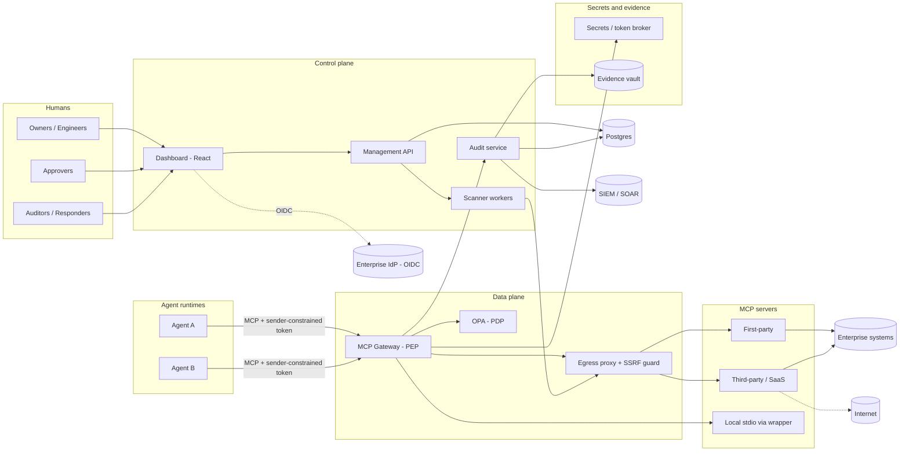
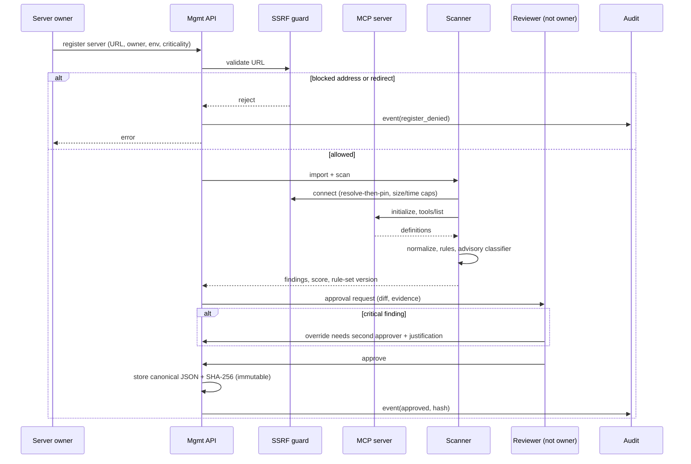
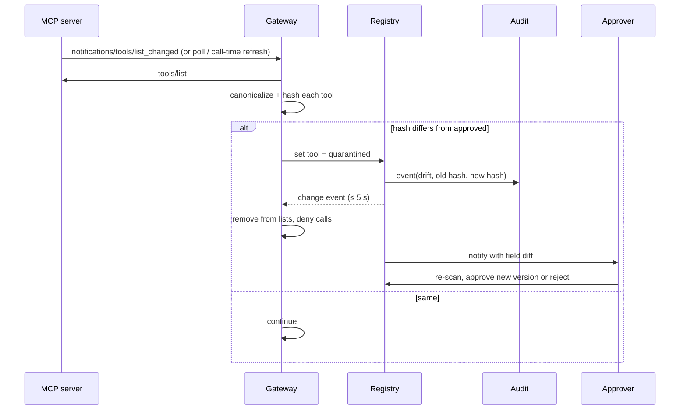
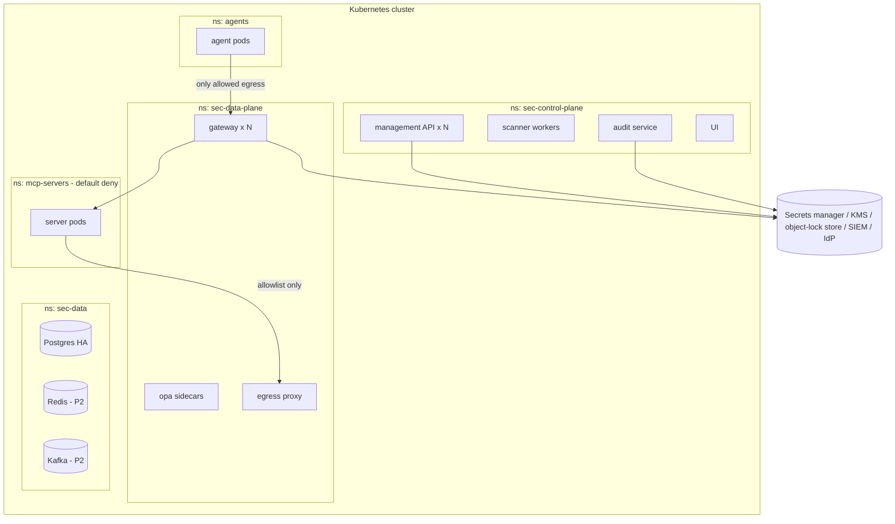

# Architecture: AgenticSecCtl

| | |
|---|---|
| Version | 0.1 (draft for review) |
| Depends on | `functional-spec.md` v0.2 (FR/NFR IDs referenced below) |
| Companion | `threat-model.md` |
| Conventions | **[VERIFY]** = product or protocol claim not yet checked against current documentation. Mermaid diagrams render in GitHub, VS Code and most markdown viewers. |

## 1. Architectural principles

1. **Deny by default, fail closed.** Unknown agent, server, tool, policy or PDP state means deny (FR-AUTHZ-1, FR-AUTHZ-8).
2. **Enforcement is deterministic.** LLM classifiers produce advisory signals only and can never be the sole control for a high-impact decision (A4, FR-RT-11).
3. **All content from servers is untrusted**, including content from approved servers.
4. **Blast-radius limits over detection.** Detection is probabilistic, so egress allowlists, taint rules, approvals and budgets bound the damage when detection fails.
5. **Every decision is reproducible** from a stored policy hash and input digest (FR-AUD-6).
6. **Reuse before build.** Policy (OPA), identity (IdP), DLP, SBOM, signing, SIEM and secrets are integrated, not rebuilt. Custom code is limited to the MCP-aware control logic that has no mature equivalent. Build-vs-extend decision for the gateway is made after technology evaluation **[VERIFY]**.
7. **Separate planes.** Data plane (gateway) and control plane (management API, scanner, UI) have separate deployments, credentials and network paths.

## 2. Trust zones and boundaries

| Zone | Contents | Trust level |
|---|---|---|
| Z0 | Humans: users, owners, approvers, admins | Authenticated by enterprise IdP with MFA |
| Z1 | Agent runtimes and their LLMs | Semi-trusted. Identity-bearing but steerable by untrusted content |
| Z2a | **Data plane**: gateway (PEP), egress proxy, OPA (PDP) | Trusted computing base |
| Z2b | **Control plane**: management API, scanner workers, registry, audit service, UI | Trusted computing base, separate admin path |
| Z2c | Secrets broker, evidence vault, KMS | Highest sensitivity |
| Z3a/b/c | MCP servers: first-party, third-party/SaaS, local stdio via wrapper | Untrusted until registered, scanned and pinned; content always untrusted |
| Z4 | Enterprise systems and data | Reached only through an approved tool and policy |
| Z5 | Internet and external content | Untrusted |

Boundary rules:
- B1: Every Z1 ↔ Z3 message crosses the PEP. Direct paths are blocked by network policy and tested (see threat model, TC-X2).
- B2: Z2a never executes tool-supplied code and never follows instructions found in tool-supplied content.
- B3: Z3 egress is deny-by-default; allowed destinations come from the registry per server (FR-RT-7).
- B4: Z2c is reachable only from named identities in Z2a/Z2b; no human interactive access to raw secrets.
- B5: The control plane can change policy and registry state but cannot read raw evidence (SoD-3, NFR-9).

## 3. System context



## 4. Component specifications

Each component lists responsibility, interfaces, state, failure behavior and the requirements it implements.

### 4.1 MCP Gateway (PEP) — data plane
- **Responsibility:** terminate agent MCP connections, authenticate, run the interceptor pipeline (Section 5), proxy to servers, enforce namespaces and `tools/list` filtering, maintain per-session state.
- **Interfaces:** in: MCP Streamable HTTP (stdio servers via wrapper in Phase 2). Out: PDP (HTTP/gRPC), broker, registry cache, audit (async outbox), egress proxy.
- **State:** session store (in-memory with Redis from Phase 2), registry cache (TTL ≤ 60 s, invalidated on change events), decision cache keyed on (policy hash, input digest) with short TTL.
- **Failure:** PDP/registry unreachable and cache expired ⇒ deny (FR-AUTHZ-8). Audit sink down ⇒ buffer to local durable queue; if queue full ⇒ deny new high-impact calls.
- **Implements:** FR-RT-*, FR-DRIFT-2/3/7, FR-AUTHN-*, FR-AUTHZ-*, FR-AUTO-*, Section 4.12 of spec.
- **Choice:** MVP uses a thin FastAPI/ASGI service on the official MCP Python SDK **[VERIFY SDK proxy support]**. Alternative: extend an open-source MCP gateway or Envoy-based AI gateway **[VERIFY]**. Decision gate before Phase 2 (ADR-1).

### 4.2 Policy Decision Point (OPA)
- **Responsibility:** evaluate Rego policy on (agent, tool, action class, resource, arguments digest, context incl. taint state, grants, approvals).
- **Deployment:** sidecar or daemonset next to the gateway for latency; bundles pulled from the control plane; signed in Phase 3 (FR-POL-3).
- **Output:** `{allow, reasons[], obligations[]}`. Obligations: `require_approval`, `redact`, `limit`, `label`.
- **Failure:** process down or bundle stale beyond TTL ⇒ gateway denies.
- **Alternative:** Cedar for entity-centric policies **[VERIFY maturity of Python integration]**; relationship stores (OpenFGA/SpiceDB) for the agent–server–tool graph if policy data grows large.

### 4.3 Egress proxy and SSRF guard
- **Responsibility:** the only path from Z2/Z3 to Z4/Z5 for platform-initiated and server-initiated traffic. Resolve DNS, validate every address against the blocklist, connect to the validated IP, re-validate redirects, enforce per-server destination allowlist.
- **Interfaces:** forward proxy (CONNECT/HTTP); library form for the importer and scanner.
- **Implements:** FR-SSRF-1..5, FR-RT-7.
- **Choice:** library for platform-initiated calls (MVP); network-level egress proxy for server pods in Phase 2 (Envoy, or cloud-native egress controls **[VERIFY]**).

### 4.4 Registry and Management API — control plane
- **Responsibility:** system of record for agents, servers, tools, versions, permissions, approvals, findings, incidents, controls.
- **Interfaces:** REST `/v1` (OpenAPI 3.1), problem+json errors, tenant-scoped.
- **State:** Postgres. `tool_versions` immutable via DB trigger; audit table append-only via restricted DB role.
- **Implements:** FR-INV-*, FR-ID-*, FR-DRIFT-1/4/5, FR-UI-*, FR-ADM-*.

### 4.5 Scanner service
- **Responsibility:** deterministic rules engine (versioned rule sets), hardened importer, advisory classifier adapter, artifact scanning hooks.
- **Pipeline:** normalize (Unicode NFC, strip/flag invisible and bidi characters, decode common encodings for analysis only) → rule evaluation → optional classifier → score → findings with evidence.
- **Isolation:** workers run unprivileged, no credentials, egress only through the SSRF guard, CPU/memory/time limits.
- **Implements:** FR-SCAN-1..8.
- **Reuse:** SBOM and vulnerability scanning via existing tools (Syft/Grype/Trivy/OSV-Scanner) **[VERIFY licences and current features]**; existing MCP scanners are evaluated as rule or corpus sources **[VERIFY]**.

### 4.6 Identity and token broker
- **Responsibility:** agent registration, OAuth client lifecycle, upstream credentials for servers, token exchange to mint audience-bound tokens, revocation list distribution.
- **Interfaces:** OIDC/OAuth 2.x with the enterprise IdP; secrets manager (Vault or cloud KMS/Secrets Manager) **[VERIFY]**.
- **Constraint:** gateway holds no long-lived upstream secrets in memory; it requests short-lived credentials per call or per session (FR-AUTHN-3, NFR-9).
- **Dependency risk:** DPoP/mTLS binding and token exchange depend on the chosen IdP **[VERIFY]**. Fallback: short-lived tokens with mTLS between agent and gateway.

### 4.7 Inspection engines (injection, DLP)
- **Interface:** `inspect(content, context) -> signals[]` with `{type, confidence, span, evidence}`.
- **Tiering:** Tier 1 deterministic (regex, structure parsing, checksum, entropy, allowlisted markup rules), inline, budget < 5 ms for typical payloads. Tier 2 small local model, async or sampled. Tier 3 LLM, escalation only, advisory.
- **Parsing:** HTML, JSON and markdown are parsed (not just regex) to expose hidden elements, comments, attributes, alt text, link targets, image URLs.
- **DLP reuse:** Microsoft Presidio and secret-scanning libraries as detectors **[VERIFY]**; custom code is limited to tenant policy, Luhn/checksum validation wrappers and redaction.
- **Implements:** FR-RT-4..6, FR-RT-11.

### 4.8 Audit and evidence service
- **Responsibility:** receive events from all services via outbox; compute hash chain; store digests and redacted excerpts; send raw evidence to vault; export to SIEM; anchor chain heads.
- **Chain:** `hash_n = SHA-256(hash_{n-1} || canonical(event_n))`; heads anchored on a schedule to object-lock storage or an external timestamping service (FR-AUD-4). The chain alone is tamper-evident, not tamper-proof; anchoring defends against a privileged DB actor rewriting history.
- **Implements:** FR-AUD-*, FR-IR-3.

### 4.9 Behavior analytics and incident manager
- MVP/Phase 2: threshold rules over audit stream (FR-BEH-1). Phase 4: per-agent baselines (FR-BEH-2).
- Incident manager: creation, containment actions (quarantine, revoke, kill switch), evidence preservation, report export (FR-IR-*). Containment propagates via change events to gateway caches within 5 s (FR-IR-2, FR-AUTO-4).

### 4.10 Discovery
- Collectors: Kubernetes API watcher, config-file scanner (MCP client configs), egress log analysis, cloud inventory adapters. Output `DiscoveredAsset` events into the registry as `unregistered` (FR-INV-5). Coverage gaps shown in UI (FR-INV-7).

### 4.11 Dashboard (React)
- OIDC login with MFA, RBAC from spec Section 2, approval queue with SoD enforcement server-side (UI hides, API enforces). Read-only graph view via API. WCAG 2.1 AA for core flows.

### 4.12 Compliance engine (Phase 3)
- Control catalogue as versioned YAML in source control, loaded into DB; mappings carry status type (mandatory / guidance / voluntary) and review date; evidence packs generated from audit and registry data, signed. No automatic compliance assertion (FR-COMP-*).

## 5. Interceptor pipeline (`tools/call`)

Ordered, short-circuit, each stage emits an audit fragment.

| # | Stage | Deterministic? | Failure action |
|---|---|---|---|
| 1 | Transport + session: TLS, origin, session binding | Yes | Reject, alert |
| 2 | AuthN: signature, iss, aud, exp, scope, sender constraint, revocation | Yes | 401, audit |
| 3 | Registry check: agent and server registered, agent→server allowed | Yes | Deny |
| 4 | Tool hash pin vs approved version (cached ≤ 60 s, re-fetch on list_changed) | Yes | Quarantine + deny |
| 5 | Limits: rate, budget, depth, loop detection | Yes | Deny / suspend session |
| 6 | PDP decision incl. taint state, grants, approvals | Yes | Deny |
| 7 | Argument guards: schema, path, SQL/command, URL via SSRF guard | Yes | Deny |
| 8 | DLP on request | Yes (Tier 1) | Redact / block |
| 9 | Approval gate if obligation `require_approval` (bound to args hash) | Human | Timeout ⇒ deny |
| 10 | Forward with brokered upstream credential via egress path | — | Error mapping |
| 11 | Response: size/schema/time limits | Yes | Block |
| 12 | Injection signals + DLP on response | Tier 1 yes, Tier 2/3 advisory | Label / redact / block / quarantine tool, per policy |
| 13 | Taint labelling; update session taint state | Yes | — |
| 14 | Audit event with policy hash and input digest | Yes | Buffer or deny high-impact if sink unavailable |

## 6. Key sequences

### 6.1 Register, scan and approve a tool



### 6.2 Authorized tool call with response inspection

```mermaid
sequenceDiagram
  participant A as Agent
  participant G as Gateway
  participant P as OPA
  participant B as Token broker
  participant S as MCP server
  participant AU as Audit
  A->>G: tools/call (token, tool, args)
  G->>G: authN, session bind, registry, hash pin
  G->>P: decide(agent, tool, action, resource, args digest, taint)
  P-->>G: allow + obligations
  opt obligation require_approval
    G->>G: hold; await human approval bound to args hash
  end
  G->>G: arg guards, DLP(request), limits
  G->>B: upstream credential (audience-bound)
  G->>S: call
  S-->>G: result
  G->>G: size limits, injection signals, DLP(response), label untrusted, update taint
  G-->>A: sanitized result
  G->>AU: event(allow, policy hash, digests)
```

### 6.3 Drift detection, quarantine and recovery



### 6.4 Incident containment

```mermaid
sequenceDiagram
  participant D as Detector / Responder
  participant IM as Incident manager
  participant R as Registry
  participant B as Broker / IdP
  participant G as Gateway
  participant V as Evidence vault
  D->>IM: open incident (finding, alert or manual)
  IM->>V: snapshot definitions, decisions, redacted traffic
  IM->>R: quarantine tool / server / agent
  IM->>B: revoke tokens and credentials
  R-->>G: change events
  G->>G: deny affected sessions (≤ 5 s)
  IM->>IM: timeline, report; recovery requires reapproval
```

### 6.5 JIT grant for a high-impact action

```mermaid
sequenceDiagram
  participant A as Agent owner
  participant API as Mgmt API
  participant H as Approver (≠ requester)
  participant P as OPA data
  A->>API: request grant (tool, action, resource, TTL, reason)
  API->>H: approval task
  H->>API: approve
  API->>P: publish grant with expiry
  Note over P: grant expires automatically; expiry audited
```

## 7. Data architecture

Authoritative schema is produced in Phase 1 via migrations; logical outline:

| Group | Tables (summary) | Notes |
|---|---|---|
| Tenancy and users | tenants, users, role_bindings | Tenant ID on every row; row-level security in Postgres |
| Inventory | agents, models, mcp_servers, tools, tool_versions, agent_server_allow, data_sources, enterprise_systems, graph_edges | `tool_versions` immutable (trigger) |
| Authorization | permissions (static/JIT, expires_at), approvals, overrides | SoD enforced by constraint and service logic |
| Security | scans, rule_set_versions, findings, incidents, evidence_items | Evidence items reference vault objects |
| Audit | audit_events (seq, prev_hash, hash, policy_hash, payload_digest, redacted_excerpt), anchor_records | Insert-only role; no UPDATE/DELETE grants |
| Governance | controls, control_mappings (status_type, review_date), evidence_packs | Phase 3 |

Retention classes: audit events, evidence vault, scan history, session data; defaults in spec NFR-6. Encryption at rest with per-tenant keys (Phase 5), TLS in transit everywhere.

## 8. Deployment architecture (cloud-neutral Kubernetes)



Controls:
- **NetworkPolicy:** `agents` egress only to gateway; `mcp-servers` ingress only from gateway, egress only via egress proxy; control-plane and data-plane cannot reach each other except on defined ports.
- **Admission policy** (Kyverno or OPA Gatekeeper **[VERIFY choice]**): signed images by digest, non-root, read-only root filesystem, no privileged, resource limits.
- **Sandboxed runtime** for servers executing code: gVisor or Kata **[VERIFY availability per cloud]**.
- **Secrets:** CSI-mounted from external manager; no secrets in manifests or images.
- **Docker Compose** profile for development and CI end-to-end tests, including hostile fixture servers on an isolated network.
- **Multi-cloud (Phase 5):** same Helm charts; cloud-specific adapters for IdP, secrets, KMS, object-lock storage, egress controls.

## 9. Availability, scale and failure behavior

| Concern | Design |
|---|---|
| Horizontal scale | Gateway is stateless apart from session cache; scale on CPU and concurrent sessions; sticky sessions or Redis-backed session state (Phase 2) |
| Latency budget | Stages 1–8 deterministic and in-memory where possible; OPA local; registry cache; target per NFR-1; classifier Tier 2/3 off the hot path |
| HA | ≥ 3 gateway replicas across zones; Postgres HA with synchronous replica; OPA per gateway pod |
| DR | RPO ≤ 5 min, RTO ≤ 30 min (Phase 5, NFR-4); audit and anchors replicated cross-region |
| Failure modes | Fail-closed default. Fail-open only for tenant-allowlisted read-only low-risk tools, always flagged in audit (FR-AUTHZ-8). Audit sink loss buffers locally then denies high-impact calls |
| Multi-tenancy | Logical isolation with tenant ID + Postgres row-level security + per-tenant policy bundles; stronger isolation (separate namespaces or clusters) available for regulated tenants |
| Data residency | Region-pinned data planes and storage per tenant (Phase 5, FR-ADM-4) |
| Backpressure | Per-tenant and per-agent rate limits protect gateway and PDP from noisy agents (FR-RT-10, FR-AUTO-1) |

## 10. Technology choices and alternatives

| Concern | Choice for MVP | Alternatives | Trade-off |
|---|---|---|---|
| Services | Python 3.12+/FastAPI, Pydantic | Go (gateway only) | Python speeds MVP and scanner work; Go may be needed if gateway latency or footprint targets fail in Phase 2 load tests |
| MCP protocol | Official MCP Python SDK **[VERIFY]** | Own minimal JSON-RPC proxy | SDK tracks the spec; proxy use may need custom code |
| Database | PostgreSQL | CockroachDB/Aurora | Familiar, strong constraints, row-level security |
| Cache/state | Redis (Phase 2) | In-memory + sticky | Needed for revocation lists and session sharing |
| Events | Outbox table → Kafka (Phase 2) | NATS, cloud-native queues | Kafka only if volume or SIEM integration needs it |
| Policy | OPA/Rego | Cedar | OPA has wide ecosystem; Cedar has formal analysis strengths **[VERIFY]** |
| Identity | OIDC; Keycloak in dev | Okta, Entra, Auth0 | Feature support (DPoP, token exchange) differs **[VERIFY]** |
| Telemetry | OpenTelemetry | Vendor agents | Vendor-neutral |
| UI | React + TypeScript | — | — |
| Deploy | Helm on Kubernetes | Kustomize, Terraform modules | Cloud-neutral |
| Supply chain | Syft/Grype/Trivy, cosign, SLSA provenance **[VERIFY]** | Cloud-native scanners | Open standards, avoids lock-in |

## 11. Requirement-to-component traceability (summary)

| Component | Primary requirements |
|---|---|
| Gateway | FR-AUTHN-1..5, FR-AUTHZ-1/2/8, FR-DRIFT-2/3/7, FR-RT-1..11, FR-AUTO-1..4, Section 4.12 |
| PDP | FR-AUTHZ-1..5, FR-POL-* |
| Egress/SSRF | FR-SSRF-1..5, FR-RT-7 |
| Registry/API | FR-INV-*, FR-ID-*, FR-DRIFT-1/4/5, FR-ADM-*, FR-UI-* |
| Scanner | FR-SCAN-*, FR-SUP-2 |
| Broker | FR-AUTHN-2/3/6, FR-ID-3 |
| Inspection | FR-RT-4..6, FR-RT-11, FR-MEM-2 |
| Audit/evidence | FR-AUD-*, FR-IR-3, FR-COMP-4 |
| Incident/analytics | FR-BEH-*, FR-IR-* |
| Discovery | FR-INV-5/7 |
| Compliance | FR-COMP-* |
| Platform | FR-OBS-*, FR-EXEC-1, FR-SUP-1, NFR-* |

## 12. Architecture decision records (open)

| ADR | Question | Options | Needed by |
|---|---|---|---|
| ADR-1 | Build the gateway vs extend an open-source MCP gateway | Custom FastAPI / extend existing / Envoy-based | Before Phase 2 |
| ADR-2 | IdP and sender-constrained token support | Keycloak/Okta/Entra with DPoP or mTLS | Before Phase 2 |
| ADR-3 | Approval channel | Dashboard only / ServiceNow / Slack | Before Phase 1 UI freeze |
| ADR-4 | Tenancy model | Single tenant per deployment / shared multi-tenant | Before Phase 1 schema freeze |
| ADR-5 | Stdio server handling | Managed wrapper / sidecar / unsupported | Phase 2 |
| ADR-6 | Policy language | Rego (default) vs Cedar | Before Phase 1 policies |
| ADR-7 | Audit anchoring target | Object-lock bucket / external timestamping | Phase 2 |

## 13. Known architectural weaknesses (accepted or mitigated)

- **Bypass:** unmanaged endpoints and local stdio servers can avoid the gateway. Mitigation: discovery, wrapper, egress controls, reporting. Residual risk accepted for unmanaged endpoints.
- **Gateway is a high-value target:** holds routing to every server and brokers credentials. Mitigation: no long-lived secrets, separate planes, hardened images, dedicated penetration test.
- **Detection is probabilistic:** a determined attacker can phrase around Tier 1 rules. Mitigation: blast-radius controls, shadow-mode tuning, red-team regression tests.
- **Definition hash limits:** same definition can hide changed behavior. Mitigation: response inspection, behavior baselines (Phase 4).
- **Approver quality:** the tool→action-class mapping depends on human judgment. Mitigation: dual control for critical overrides, periodic recertification, unused-permission reports.
- **Single approval channel in MVP** concentrates risk in the dashboard session. Mitigation: MFA, step-up authentication for approvals.
