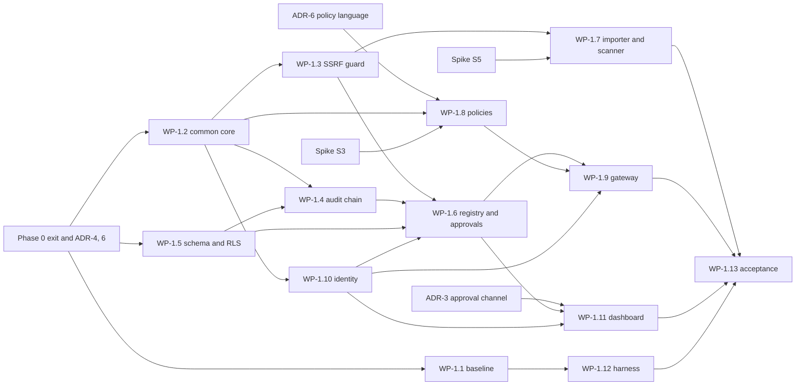

# Implementation Plan: AgenticSecCtl (Phase 1 in build detail, Phases 2 to 5 outlined)

| | |
|---|---|
| Version | 0.8 (plan draft; v0.8 aligns the spike sentence of Section 6.3 with the roadmap's new schedule; v0.7 records the Phase 0 spikes and updates the dependency table, WP-1.2 and WP-1.5; nothing is built, all estimates are unvalidated; v0.5 incorporates the High gaps IG-3 and IG-5 of `docs/implementationgaps.md`, on top of the Medium gaps in v0.4, the Low gaps in v0.3 and IG-1 and IG-2 in v0.2; every gap in the register is now incorporated) |
| Date | 2026-11-22 |
| Depends on | `Plan/functional-spec.md` v0.8, `Plan/architecture.md` v0.6, `Plan/threat-model.md` v0.5, `docs/roadmap.md` v0.5, `docs/data-model.md` v0.3, `docs/api-specification.md` v0.3, `docs/authn-authz-design.md` v0.3, `docs/cross-cutting-design.md` v0.1, `docs/testing/cases.md` v0.5, `controls/catalogue.md` v0.6, `docs/deployment-architecture.md` v0.4, `docs/ci-cd-pipeline.md` v0.8, `docs/parameter-register.md` v0.3, `docs/governance.md` v0.6 |
| Purpose | Turn the Phase 1 scope of the roadmap into an ordered, testable work breakdown that engineers can start from: modules, interfaces, work packages, schedule, test strategy, definition of done. Later phases are sequenced at lower confidence. |
| Status | **Plan only.** No product code has been written; two spikes exist (`policy/`, the Rego sketch run under OPA, and `db/spike/`, the core tables run on PostgreSQL). Library names and versions are partly verified (Section 4.3); versions are not pinned. Open decisions (ADR-1..7) are not decided here: the plan builds on the proposed defaults in the design documents and says what changes if a decision differs. Effort and duration figures are proposals for the re-baseline checkpoints in the roadmap, not commitments. |

## 1. How to read this plan

The roadmap (`docs/roadmap.md`) says *what* each phase delivers and when it may be accepted. The specification says *what the platform shall do*. This plan says *in which order and by which work packages* Phase 1 is built, what each package touches, which tests are written first and when a package counts as done. Work packages are named WP-1.1 to WP-1.13 for Phase 1 and WP-2.x to WP-5.x for later phases.

Scope of detail: Phase 1 is planned to work-package level because its inputs (ADR-3, ADR-4, ADR-6, spike S5) are close to decision. Phases 2 to 5 depend on spikes S1 to S4 and S6 and on measured Phase 1 velocity, so Section 9 only sequences them.

## 2. Principles and invariants that the code must preserve

Each invariant is a design rule from `CLAUDE.md` and the architecture. A package is not done if it weakens one. The last column names where it is proved.

| Invariant | What it means for code | Proved by |
|---|---|---|
| Deny by default, fail closed | Unknown entity, unreachable PDP, expired registry cache or stale bundle returns deny; an unexpected exception on a security path is a denial, not a pass (`docs/cross-cutting-design.md` Section 5) | TC-F1, TC-Z5, unit tests on every decision function |
| Deterministic enforcement | Rules and policy decide; the classifier is a pluggable stub that can raise a score but never block alone (FR-SCAN-3) | Scanner tests with the stub disabled and enabled give the same blocking decisions |
| Immutable, pinned definitions | Approved definitions are stored as canonical JSON (RFC 8785) plus SHA-256; rows in `tool_versions` are never updated; a hash change quarantines | TC-B1..B3, database constraint tests |
| Reproducible decisions | Every decision stores the policy bundle hash and an input digest | TC-Z20, FR-AUD-6 |
| Tamper-evident audit | Hash chain `hash_n = SHA-256(hash_{n-1} || canonical(event_n))` with a verifier; tamper-evident, not tamper-proof | TC-Z6 |
| SSRF at every connection | Resolve, validate, pin the address, re-validate on every redirect, for registration, import, health check and later proxying | TC-H1..H4 |
| Separation of duties server-side | The API refuses self-approval; the UI only hides buttons | TC-E4, TC-Z7 |
| No secrets in logs, findings or UI | Redaction at the source plus a central filter; debug mode does not disable it | TC-G5 |
| Tenant ID on every row | Row-level security enforced in the database regardless of the tenancy decision | schema tests, ADR-4 note in Section 3 |
| Planes stay separate | `gateway` (data plane) and `api`/`scanner` (control plane) import only from `common`, never from each other | an import-boundary check in CI (WP-1.1) |

## 3. Decisions the plan depends on

| Item | Needed before | Working default used in this plan | If the decision differs |
|---|---|---|---|
| ADR-4 tenancy (shared multi-tenant with row-level security, tenant ID everywhere) | Schema freeze (end of week 2 of Phase 1; ADR-4 must be decided by the end of week 1) | Shared multi-tenant; tenant ID on every table; policies on every table | WP-1.5 schema and WP-1.6 API change; dedicated-database option adds deployment work, not new tables |
| ADR-3 approval channel (dashboard only) | UI freeze | Dashboard approval queue for tool definitions and agent registrations (call-time approvals bound to the argument hash are outside Phase 1) | Adapters are Phase 2 or later; no Phase 1 change |
| ADR-6 policy language (Rego on OPA) | Start of WP-1.8 | Rego | Cedar would replace WP-1.8 and the PDP client in WP-1.9 |
| Spike S5 scanner baselines (week -6 to -5) | Start of WP-1.7 design | Own deterministic rules plus corpus; external scanners only as comparison | Scanner scope may shrink if an external engine proves sufficient |
| Spike S3 policy latency | WP-1.8 caching design | Sidecar OPA, decision cache keyed by policy hash and input digest | Cache design changes in WP-1.9 |
| Spike S2 identity capabilities | Phase 2 (ADR-2) | Keycloak for development only; plain OIDC bearer validation in Phase 1 | None for Phase 1 |
| Parameters with gate B1 (`docs/parameter-register.md`: importer limits, bundle staleness limit, SSRF exception expiry, approval timeout, build-failing severities) | Start of the package that uses them | Values proposed by the security engineer at the start of each package and recorded in the register | Defaults are configuration, so a changed value is not a code change |
| Customer answers CI-1..CI-15 | Per `docs/customer-inputs.md` | Working assumptions in that document, none confirmed | Revisit the package named in each assumption |

## 4. Target code architecture for Phase 1

### 4.1 Packages and modules

Python 3.12 or later, one package per service as in the scaffold (`services/<name>/src/agenticsecctl_<name>`). Module names are proposals.

| Package | Plane | Modules (proposed) | Responsibility in Phase 1 |
|---|---|---|---|
| `common` | shared | `canonical` (RFC 8785 JSON canonicalisation and SHA-256), `auditchain` (event model, chain, verifier), `ssrf` (resolve-validate-pin guard), `redact` (log and error redaction), `config` (typed settings and validation), `errors` (catalogue and problem details), `ids`, `telemetry` (OpenTelemetry bootstrap), `contracts` (PDP input and output models, event vocabulary) | Security primitives used by all services; no business logic, no network listeners |
| `api` | control | `registry` (agents, servers, tools, versions), `approvals` (requests, decisions, separation of duties), `findings`, `audit` (outbox, chain writer for API and gateway events, event-submission endpoint, verification endpoint; see Section 4.4), `auth` (OIDC validation, role bindings), `classification`, `health` | Management API and database access; applies row-level security; produces audit events through an outbox |
| `scanner` | control | `importer` (hardened fetch and parse), `normalise`, `rules`, `scoring`, `classifier` (stub interface), `worker` | Isolated import and scan jobs; no database writes except through the API |
| `gateway` | data | `server` (MCP endpoint, Origin and transport checks), `authn`, `registry_client` (cached registry view), `listfilter`, `pin` (recompute and compare hashes), `pdp_client`, `upstream` (guarded Streamable HTTP client and forwarding), `failclosed`, `events` (bounded buffer and submission to the API) | Thin policy enforcement point: `tools/list` filtering, pinned-tool allow or deny, quarantine, decisions through OPA; no response inspection yet |
| `web` | control | `app` (React and TypeScript), pages for counters, drill-down, approval queue, diff view | Small dashboard |
| `policy` | data | `rego/` (policies), `tests/` (Rego tests), bundle build script | Policies and their tests |
| `db` | control | `migrations/` | Schema, row-level security, roles, constraints |

### 4.2 Interface contracts (already designed, reused)

| Interface | Source of truth | Notes for the build |
|---|---|---|
| Management API | `docs/api-specification.md` Section 2, `docs/api/openapi.yaml` | Phase 1 subset: agents, servers, imports, tools and versions, quarantine, approvals, findings, audit events and verification, classification levels, health |
| PDP input and output | `docs/authn-authz-design.md` Section 5 | The gateway supplies every field; `args_digest` replaces arguments; output is `allow`, stable `reasons`, `obligations` |
| Audit events | `Plan/architecture.md` Section 4.8 | Phase 1 emits the subset for registration, scan, approval, quarantine, decision and verification events |
| Tables and constraints | `docs/data-model.md` Sections 3 to 6 | Illustrative SQL is a starting point, not validated |
| Logging, errors, configuration | `docs/cross-cutting-design.md` | Same behaviour in every service through `common` |
| MCP behaviour | `docs/mcp-compatibility.md` (revision 2026-07-28) | The thin gateway must handle requests without an initialize handshake and the `server/discover` call |

### 4.3 Dependencies (partly verified on 2026-11-22; versions still to be chosen and pinned)

| Need | Candidate | Note |
|---|---|---|
| HTTP framework and models | FastAPI, Pydantic | From the approved stack; both MIT (repository metadata) |
| MCP protocol | Official MCP Python SDK | Verified: MIT; v2 (latest v2.3.0) states it implements revision 2026-07-28 and negotiates back; not run here. Keep the thin interface around it (Section 10 risk) |
| Database | PostgreSQL with row-level security (17.12 runs the core-table spike, `db/spike/`); a migration tool and a driver | Decided 2026-11-23 (PAR-O-27, PAR-O-28 in `docs/parameter-register.md`): plain SQL migrations with a small runner, and psycopg 3 with psycopg-pool and raw SQL (psycopg and psycopg-pool 3.3.x are LGPL-3.0-only; accepted, legal review pending). Constraint kept: the tenant is set per transaction (IG-9) |
| Policy | OPA and `opa test` | Verified: Apache-2.0; 1.22.4 runs the spike policy (`policy/`, 15 tests) |
| HTTP client for importer and health checks | `httpx` or similar | Must allow connecting to a pinned address while keeping the host name for TLS |
| Tests | `pytest` (MIT), a property-testing library (Hypothesis is MPL-2.0, test-only), a fuzzing harness | Property tests for canonicalisation and the chain. Coverage thresholds are open (PAR-O-26); Section 7 gives the proposal |
| Frontend | React, TypeScript, a bundler, a browser test runner | |
| Identity for development | Keycloak | Development only; Apache-2.0, latest release 26.8.2 (repository metadata); not run here |
| Static checks | Linter, type checker, SAST, secret scanning, dependency scanning | Gates G1.1..G1.10 in `docs/ci-cd-pipeline.md` |

### 4.4 Phase 1 design notes for the gateway (IG-3, IG-5)

These notes are proposals for the security architect to confirm at checkpoint R1 (Section 8.1). They fix what WP-1.4, WP-1.6 and WP-1.9 build.

**Upstream forwarding (IG-3).**

- **Transport:** Streamable HTTP only, in both directions. stdio servers are out of scope until the wrapper in Phase 2 (WP-2.6); a registration with another transport is refused.
- **Proxying:** the gateway proxies `tools/list` and `tools/call` for registered servers. On every `tools/list` it fetches the upstream list (FR-DRIFT-2), recomputes the hashes, filters the result and answers; a scheduled refresh at the cache interval covers servers nobody is listing. A `tools/call` is forwarded only after the decision allows it, the tool is approved and its hash matches; a call to a quarantined or unknown tool never reaches the upstream server (the fixtures count upstream calls to prove it).
- **Connections:** the upstream URL comes only from the registry, never from the request. Every upstream connection uses the guarded client of WP-1.3 (resolve, validate, pin the address, no redirects), as FR-SSRF-1 requires, so a registry entry that later resolves to an internal address is refused at connect time.
- **Upstream credentials:** none in Phase 1. Fixture and Phase 1 servers are onboarded without an upstream credential, the gateway stores no static upstream secret (NFR-9), and the agent's own token is never forwarded upstream (no token passthrough). A server that needs a credential is not onboarded until the broker exists (WP-2.4). Registration records the credential mode as `none` and refuses anything else.
- **Limits:** a fixed upstream timeout and maximum response size apply even though response inspection does not exist (an exceeded limit is an error, not a pass).

Which of the 14 interceptor stages of `Plan/architecture.md` Section 5 exist in Phase 1:

| # | Stage | Phase 1 |
|---|---|---|
| 1 | Transport and session | Partly: Origin check; TLS is a deployment matter; no session binding (the 2026-07-28 revision has no protocol sessions) |
| 2 | AuthN | Yes: signature, issuer, expiry, audience, scope. Revocation relies on the short token lifetime (10 minutes, PAR-F-03); no sender constraint |
| 3 | Registry check | Yes |
| 4 | Tool hash pin | Yes |
| 5 | Limits (rate, budget, depth, loops) | No (Phase 2); only the fixed size and time limits above |
| 6 | PDP decision | Yes |
| 7 | Argument guards | No (Phase 2); the SSRF guard on the upstream connection applies |
| 8 | DLP on request | No |
| 9 | Approval gate | No: call-time approvals are outside Phase 1 |
| 10 | Forward | Yes, without a brokered credential (see above) |
| 11 | Response limits | Size and time only |
| 12 | Injection and DLP inspection | No |
| 13 | Taint labelling | No |
| 14 | Audit event | Yes (see the next note) |

**Audit path (IG-5).**

- **Where the chain is written:** in Phase 1 the chain writer is the `audit` module inside `api`, using the `common.auditchain` library. This differs from `Plan/architecture.md` Section 4.8, which describes a separate audit service; that service arrives in Phase 2 (WP-2.5, with anchoring) and takes over the same module and event contract, so the gateway does not change.
- **API-originated events** (registration, approval, quarantine, scan) are written through the outbox in the same transaction as the change they describe.
- **Gateway events** go to an authenticated endpoint of the API (`POST /internal/audit/events`, batched), using the gateway's own machine identity, not an agent or user token. The gateway never computes the chain; the API assigns the per-tenant sequence number and hashes inside one transaction that serialises writers per tenant (a lock on the chain head). Each event carries an event ID created at the gateway, and the API ignores a repeated ID so a retry cannot duplicate an event.
- **Buffering:** the gateway holds a bounded in-memory buffer and flushes it on an interval (capacity and interval are PAR-O-29). A part of the capacity is reserved for deny events so that denials are still recorded when allow events fill the rest.
- **Full buffer or unreachable API:** when the buffer is full, or the API has been unreachable for longer than the flush limit, the gateway denies every `tools/call` that would otherwise be allowed (in Phase 1 every call is treated as high-impact) and records the denial in the reserved space. If even the reserved space is full, further deny events are dropped and counted; the count is reported on the next successful flush and raises an alert. The count is recorded in an `audit.buffer_full` event (already in the vocabulary of `Plan/architecture.md` Section 4.8).
- **Accepted residual risk:** events still in the buffer are lost if the gateway process crashes. The flush interval bounds the loss, and the loss is recorded in the acceptance report; the Phase 2 service and a durable local queue remove it.
- **Database role:** only the `audit` module connects as the audit writer role; the gateway has no database access.

## 5. Work packages for Phase 1

Estimates are person-weeks with a range; they sum to a total in Section 6. "Tests first" lists what is written before the production code.

### WP-1.1 Repository and engineering baseline
- **Purpose:** a working build, test and CI skeleton so every later package lands with checks.
- **Covers:** CTL-27, NFR-9 (secure development), CI gates for the code that exists (G1.1..G1.10).
- **Tasks:** per-package project files with dependencies and tooling configuration; shared lint, type and test configuration; Compose file for PostgreSQL, OPA, Keycloak (development) and the fixture network; import-boundary check (gateway versus api and scanner); pre-commit; start `.github/workflows` product workflow only after the action pins in `docs/ci-cd-pipeline.md` Section 12 are re-verified and a remote exists (otherwise run the same commands locally); README per package; developer onboarding guide (clone, start Compose, run the checks, add a test case with its TC identifier).
- **Tests first:** the import-boundary check fails on a deliberate bad import; secret-scan check fails on a dummy token string.
- **Done when:** one command runs lint, types and tests for all packages locally; CI template gates that apply run clean; a developer can start the Compose stack.
- **Estimate:** 1.5 to 2. **Depends on:** Phase 0 exit. **Risk:** CI cannot be exercised without a remote (see `docs/repository-setup.md`).

### WP-1.2 `common` core: canonical JSON, redaction, errors, configuration, telemetry
- **Covers:** FR-ADM-1, FR-OBS-1, FR-AUTHN-6, the hashing part of FR-DRIFT-1; TC-G5, TC-Z10.
- **Tasks:** canonicaliser per RFC 8785 including number formatting, with the RFC test vectors; SHA-256 helper; redaction filter for logs, errors and findings; typed configuration with validation at start, layering and safety bounds (`docs/cross-cutting-design.md` Section 6); configuration version hash and `config.changed` event shape; error catalogue and problem-details builder; OpenTelemetry bootstrap without payloads.
- **Hashed definition fields (IG-8, proposal):** the hash input is the canonical JSON (Unicode NFC applied to every string first) of an object holding the server ID and the tool object as returned by the server with these fields: `name`, `title`, `description`, `icons`, `inputSchema`, `outputSchema`, `annotations`. Rules: (1) any other field present in the tool object (an unknown or extension field) is also hashed, so adding, removing or changing it changes the hash, and a finding is raised for the unknown field; (2) list-level metadata (`ttlMs`, `cacheScope`, `resultType`) and `_meta` are not hashed; (3) absent and `null` are different; (4) array order is significant. Per-authorization-context lists: one approved definition exists per tool, and the list returned for each requesting identity is compared with it tool by tool; a tool missing from a particular context's list is not drift, but any tool that appears must match the approved hash. FR-DRIFT-1 in the specification (v0.8) and `docs/mcp-compatibility.md` Section 3A now list the same fields.
- **Tests first:** one test vector per hashed field showing that a change alters the hash, and vectors showing that `ttlMs`, `cacheScope` and `_meta` do not; an unknown extra field changes the hash and raises a finding; RFC 8785 vectors and property tests (key order, Unicode, numbers); redaction tests across error and debug paths (TC-G5); configuration rejects unknown keys and out-of-range values (TC-Z10).
- **Done when:** no service starts with invalid configuration; no secret survives the redaction suite; canonical hashes are stable across runs and machines.
- **Estimate:** 2 to 3. **Risk:** number serialisation edge cases; mitigate by testing against the RFC vectors and a second implementation.

### WP-1.3 `common` SSRF guard
- **Covers:** FR-SSRF-1..5, CTL-08; TC-H1..H4, AC-4.
- **Tasks:** address classification (loopback, link-local including 169.254.169.254, private ranges, IPv4-mapped IPv6, unique-local, multicast, reserved); parsing of alternate encodings (decimal, octal, hex, IPv6 forms, userinfo tricks); resolve then pin the validated address for the connection; redirects off by default and re-validated per hop with a limit; per-server exception entries with owner, reason and expiry; a client wrapper that cannot be used without the guard. The wrapper is the only HTTP client in the repository, and covers identity-provider discovery and key-set (JWKS) fetches by the gateway and the API as well as registration, import, health checks and upstream proxying. The development Keycloak is reachable on a private address, so it gets an exception entry (IG-4): scoped to the one host and port, development environment only, with an owner (security engineer), a reason and an expiry (PAR-O-03); the entry is configuration, never a code path that skips the guard.
- **Tests first:** an identity-provider discovery URL on a private address is refused without an exception entry, allowed with one, and refused again after the entry expires; a table of hostile inputs and expected rejections; a rebinding test server that changes its DNS answer between check and connect; redirect to an internal address.
- **Done when:** all four threat-H cases pass against the hostile fixtures; registration, import, health check and identity-provider fetches use the wrapper only (the import-boundary check in WP-1.1 also rejects any other HTTP client).
- **Estimate:** 1.5 to 2. **Depends on:** WP-1.2 (errors, config). **Risk:** platform differences in address parsing; test on the CI operating system and the container base image.

### WP-1.4 `common` audit chain, verifier and decision replay
- **Covers:** FR-AUD-1, FR-AUD-2, FR-AUD-6, FR-POL-2 (policy hash recorded), CTL-13; TC-Z6, TC-Z20, AC-5.
- **Tasks:** event model with tenant, sequence, time, type, actor, subject, decision, policy hash, input digest, redacted excerpt; chain computation; verifier that reports modified, deleted and reordered events; command-line verification; replay function that re-evaluates a stored decision from the policy hash and input digest.
- **IG-5 additions:** the chain writer in `api` serialises writers per tenant, accepts batched gateway events through an authenticated internal endpoint, and ignores a repeated event ID (Section 4.4).
- **Tests first:** concurrent writers for one tenant produce a gap-free sequence with a valid chain; a resubmitted batch adds no events; tamper, delete and reorder cases (TC-Z6 chain part); replay reproduces recorded decisions (TC-Z20). Detection of a full-chain rewrite needs an anchor and is Phase 2 (TC-Z22), per the split already made in the test catalogue.
- **Done when:** verifier detects each tamper class; replay matches on a recorded sample.
- **Estimate:** 2.5 to 3.5. **Depends on:** WP-1.2 (canonical form), WP-1.5 (storage) for the database-backed run.

### WP-1.5 Database schema, migrations, roles and row-level security
- **Covers:** tenancy foundations (ADR-4), FR-DATA-1, immutability support for FR-DRIFT-5, CTL-22 groundwork.
- **Tasks:** migrations for tenancy and access, inventory, authorization, findings, audit and governance tables as in `docs/data-model.md` Section 3; `tool_versions` without update or delete permission and with a trigger or rule that rejects changes; row-level security policies on every table; database roles (application, audit writer, read-only, migration owner); classification levels table; `scan_jobs` (IG-6, `docs/data-model.md` Section 3.4), which must be in the schema before the freeze. **Tenant setting (IG-9):** each request sets the tenant inside its own transaction (`set_config('app.tenant_id', ..., true)`), session-level settings are forbidden, an unset tenant matches no rows, and application roles have neither superuser nor `BYPASSRLS`; the connection pool resets session state on return as a second defence.
- **Documentation:** keep `docs/data-model.md` in step with the migrations; record the migration and access-layer decisions (Section 4.3).
- **Starting point:** `db/spike/` already runs the core tables, forced row-level security, composite tenant foreign keys and the immutability triggers on PostgreSQL 17.12 (78 checks); WP-1.5 extends it to the full data model.
- **Tests first:** interleaved requests for two tenants over a pool of one connection never see each other's rows, and a request that does not set a tenant sees no rows (IG-9); a cross-tenant read and write attempt fails for each table; an update of `tool_versions` fails for every application role; migration up and down on an empty database.
- **Scheduling:** starts in week 1 on its own lane so the tables can be frozen at the end of week 2; roles, row-level security tests, constraint tests and indexes finish in weeks 3 to 4. Changes to frozen tables need the security architect's approval.
- **Done when:** schema is frozen (ADR-4 decided), tests above pass, indexes for the main queries exist.
- **Estimate:** 2 to 3. **Depends on:** ADR-4 and `docs/data-model.md` only (not on WP-1.2). **Risk:** schema churn after freeze; keep tenant ID everywhere so the dedicated-database option stays open.

### WP-1.6 Registry API, approvals and separation of duties
- **Covers:** FR-INV-1..3, FR-ID-1..2, FR-DRIFT-1, FR-DRIFT-5, FR-SCAN-4, FR-DATA-2, SoD-1..3, CTL-01, CTL-23; TC-C1, TC-E4.
- **Tasks:** endpoints for agents, servers, tools, versions, approvals and findings per the OpenAPI outline; namespace rule `namespace__tool` and duplicate-name flagging; approval request with the canonical definition and hash stored on approval; re-approval creates a new immutable version; Critical findings block approval except through the two-approver override; server-side separation-of-duties checks; classification default Confidential on registry items; audit events written through an outbox in the same transaction; registration calls the SSRF guard before storing a URL.
- **Documentation:** API reference generated from the OpenAPI outline and checked against the implemented endpoints (error codes and role table included).
- **Tests first:** self-approval is refused; Critical override needs two distinct approvers; duplicate tool names across servers are flagged; tenant isolation through the API.
- **Done when:** the approval lifecycle works end to end against the database with audit events produced.
- **Estimate:** 3 to 4. **Depends on:** WP-1.2, WP-1.3, WP-1.4, WP-1.5 (frozen tables), WP-1.10 (identity).

### WP-1.7 Importer, scanner v1 and corpus baseline
- **Covers:** FR-SCAN-1..3, FR-SCAN-6, CTL-02; TC-A1..A5, TC-Z2; AC-1, AC-8.
- **Tasks:** hardened importer in an isolated worker with connection, time, size, depth and item limits, no redirects by default and the SSRF guard; normaliser (Unicode normalisation, hidden characters, bidirectional controls, encoded content detection); deterministic rules for override phrases, credential requests, exfiltration URLs, cross-tool instructions, concealment, schema anomalies and homoglyphs; scoring that is reproducible with evidence excerpts and rule IDs; classifier interface with a stub; baseline measurement of precision and recall on `tests/fixtures/corpus/`. **Job dispatch and isolation (IG-6, proposal):** `POST /servers/{id}/imports` inserts a row in `scan_jobs` (database job table, no Redis or Kafka before Phase 2). The scanner worker has its own machine identity (an OIDC client distinct from every agent and user, created in WP-1.10) and talks only to the API: it claims a job (the API selects with `FOR UPDATE SKIP LOCKED` and sets a lease), renews or completes it, and posts scan results and findings back through the API. A job whose lease expires returns to the queue until `max_attempts`, then fails with a recorded reason and an `import.failed` event. The worker runs as a separate container and unprivileged process with no database credentials and no secrets, under a network policy that allows only the API and, through the SSRF guard, the import target; a malformed import can crash the worker but not the API. The internal claim and result endpoints are added to the OpenAPI outline in WP-1.6.
- **Tests first:** two workers never claim the same job; an abandoned job is re-queued after the lease and fails after `max_attempts`; from the worker container a direct database connection and a connection to an internal address both fail (isolation test); every corpus item has an expected label; the hostile server that is oversized, deeply nested, slow and redirecting (AC-8); fuzzing of the importer and normaliser.
- **Done when:** poisoned seeds score High or Critical with evidence, benign seeds do not, and the measured numbers are reported against the 95 percent recall and 90 percent precision targets even if not met (the corpus is too small to prove either).
- **Estimate:** 4 to 5. **Depends on:** WP-1.2, WP-1.3, spike S5, corpus growth. **Risk:** false positives and low recall; keep the classifier advisory and review findings in shadow.

### WP-1.8 Policies and policy tests
- **Covers:** FR-POL-1..2, FR-AUTHZ-1..3, FR-AUTHZ-8, CTL-06, CTL-16 (Phase 1 part); TC-C3, TC-E1; AC-3, AC-7.
- **Tasks:** Rego policy following `docs/authn-authz-design.md` Section 4 and the decision contract in Section 5; bundle build with a content hash; staleness handling (limit from the parameter register); deny-by-default rules; agent to server allowlist; per-tool and action-class permissions with optional resource constraints; unit tests in `policy/tests`.
- **Tests first:** table of inputs and expected decisions (no grant denies, grant allows, read-only cannot write or delete, unregistered denied); a test that a missing input field denies.
- **Done when:** `opa test` passes in CI, every decision includes the bundle hash, and stopping OPA results in deny at the gateway (with WP-1.9).
- **Estimate:** 2 to 3. **Depends on:** ADR-6, spike S3 results, WP-1.2 (contracts).

### WP-1.9 Thin gateway: list filtering, pin check, decisions
- **Covers:** FR-RT-1, FR-DRIFT-2..3, FR-INV-4, FR-AUTHN-1, FR-AUTHZ-8, FR-MCP-4, CTL-03, CTL-05 (Phase 1 part); TC-B1..B3, TC-F1, TC-F2, TC-G2, TC-Z5; AC-2, AC-7.
- **Tasks:** MCP endpoint that validates the Origin header and token (signature, issuer, expiry, audience); registry client with a cache (60 s) that denies when the cache expires and the registry is unreachable; recompute the definition hash on every `tools/list` and on list-changed notifications and compare with the approved hash; quarantine on mismatch and remove the tool from list results and block calls; call the PDP with the contract fields and enforce the answer; fail closed everywhere; audit events for decisions (buffered and submitted as in Section 4.4); proxying of `tools/list` and `tools/call` upstream through the guarded client as in Section 4.4; no response inspection yet. **Effect time of registry changes (IG-7):** in Phase 1 a quarantine, revocation or approval change reaches the gateway when its registry cache entry expires, so the guarantee is at most the cache TTL (60 s, PAR-F-02) plus one registry round trip, not the 5 seconds of PAR-F-01. The gateway also caps the TTL at the server's `ttlMs` when that is smaller. The 5 second effect time is a Phase 2 target met by change events pushed to gateways (WP-2.6, with Redis or Kafka); until then AC-2 is read as "by the next `tools/list` after the cache expires". Registry unreachable with an expired cache still denies.
- **Documentation:** gateway operator notes: configuration, fail-closed behaviours and what each denial reason means, as input to the Phase 1 runbook items.
- **Tests first:** a call to a quarantined tool never reaches the upstream fixture (its call counter stays at zero) and no agent token or credential is forwarded; a registry entry that resolves to an internal address is refused at connect time; a full audit buffer or an unreachable API denies calls that would be allowed, deny events are still recorded in the reserved space, and a resubmitted batch adds no events; the measured delay between a quarantine in the registry and the first denied call is at most the cache TTL plus a small tolerance, and the measured value is recorded in the acceptance report (IG-7); an identity-provider key-set fetch that fails with an expired cache denies; changed description, widened schema and flipped annotation each quarantine by the next list; a call made after quarantine fails; an unregistered agent is denied; forged token and wrong audience are denied; stopping OPA denies.
- **Done when:** AC-2, AC-3 and AC-7 pass in the end-to-end harness (WP-1.12).
- **Estimate:** 3.5 to 5 (raised by half a week to one week for forwarding and the audit buffer, IG-3 and IG-5). **Depends on:** WP-1.2, WP-1.4 (event endpoint), WP-1.6, WP-1.8, WP-1.10. **Risk:** scope creep into inspection; the roadmap excludes it from Phase 1.

### WP-1.10 Identity, OIDC and role bindings
- **Covers:** FR-UI-7, FR-ID-1..2 (client and owner), FR-AUTHN-1 (token source), CTL-23; supports TC-F2, TC-G2.
- **Tasks:** Keycloak development realm with users per role, an agent client per test agent and MFA flow for dashboard users; token validation library in `common` used by api and gateway; role binding table and server-side role checks per the endpoint table; machine identities for agents and for the scanner worker with distinct credentials; identity-provider discovery and key-set fetches go through the guarded client (WP-1.3) with the development exception entry.
- **Tests first:** each endpoint refuses roles not listed in `docs/api-specification.md` Section 2; shared credentials between agents are rejected.
- **Done when:** the harness logs in as every role and every agent without static shared secrets.
- **Estimate:** 1.5 to 2. **Note:** development identity only; the production IdP is ADR-2 and spike S2.

### WP-1.11 Dashboard MVP
- **Covers:** FR-UI-1..3, FR-UI-7, FR-DRIFT-4, CTL-28 (Phase 1 part); TC-Z7; AC-6.
- **Tasks:** counters (agents, servers, tools, approved and unapproved, quarantined, critical findings); drill-down per agent, server and tool with owner, environment, criticality, risk and findings; approval queue with a field-level diff between approved and current definitions and evidence; error and empty states; accessibility checks for core flows. Layout and flows follow `docs/ux-outline.md`.
- **Tests first:** component tests for diff rendering; browser tests for the approval flow with a seeded fleet; requester cannot approve own request even if the button is forced.
- **Done when:** TC-Z7 and AC-6 pass on a seeded fleet.
- **Estimate:** 3 to 4. **Depends on:** WP-1.6 and WP-1.10 APIs; ADR-3 (UI freeze).

### WP-1.12 End-to-end harness and fixtures
- **Covers:** all Phase 1 test cases; findings F6 of the roadmap.
- **Tasks:** Compose environment on an isolated network; fixture MCP servers per `docs/testing/fixtures-and-corpora.md` (benign server, poisoned descriptions, rug-pull server that changes after approval, hostile importer target, rebinding DNS server, redirecting server); test driver that exercises agent, gateway, API and dashboard; reports mapping each run to TC identifiers; the seed corpus loader.
- **Seed fleet (proposal, for TC-Z7 and AC-6):** a versioned seed under `tests/fixtures/seed/`, loaded by one command and idempotent, with an expected-counters file stored beside it so counters can be compared with database queries. Two tenants (the second only for isolation checks). In the main tenant: 12 agents, 8 servers and about 60 tools covering every state (approved, pending, quarantined, rejected, deprecated); at least 3 pending approvals, one of them a drift diff on an approved tool; findings at every severity including at least one Critical; one agent with no owner (negative case). Users: viewer, engineer, server owner, approver and auditor, plus a second approver for the override path; one approval requested by a user who also holds the approver role (the self-approval case). Counts are proposals and are fixed when the seed is written.
- **Tests first:** the harness itself is tested by a failing fixture that must make a case fail.
- **Done when:** all 26 Phase 1 cases can be run with one command and the report names each case and result.
- **Estimate:** 3 to 4. Starts in week 1 with the first fixture and grows with each package.

### WP-1.13 Hardening, acceptance run and runbook exercise
- **Covers:** AC-1..AC-9, roadmap acceptance criteria and gate checklist.
- **Tasks:** run all 26 Phase 1 cases and record results and exceptions; measure scanner precision and recall and report them; run the dependency, secret and SAST checks and resolve or waive findings; exercise the Phase 1 runbook items once (fail-closed behaviour, database restore with chain verification) and update `docs/runbooks/operational-runbook.md`: replace each `[TBD]` for Phase 1 items with the real command, metric or alert name, and add the procedures the exercise showed to be missing (parameter PAR-O-24); gather evidence for the gate review, including the fuzzing results for R3 and the evidence pack for the independent review R4; re-baseline the estimate for Phase 2.
- **Estimate:** 2 to 3.

## 6. Effort, team and schedule

### 6.1 Effort

| WP | Package | Person-weeks (low to high) |
|---|---|---|
| 1.1 | Repository and baseline | 1.5 to 2 |
| 1.2 | `common` core | 2 to 3 |
| 1.3 | SSRF guard | 1.5 to 2 |
| 1.4 | Audit chain and replay | 2.5 to 3.5 |
| 1.5 | Schema and row-level security | 2 to 3 |
| 1.6 | Registry, approvals, SoD | 3 to 4 |
| 1.7 | Importer and scanner | 4 to 5 |
| 1.8 | Policies | 2 to 3 |
| 1.9 | Thin gateway | 3.5 to 5 |
| 1.10 | Identity and roles | 1.5 to 2 |
| 1.11 | Dashboard | 3 to 4 |
| 1.12 | Harness and fixtures | 3 to 4 |
| 1.13 | Hardening and acceptance | 2 to 3 |
| | **Total** | **31.5 to 43.5** |

The roadmap's team assumption (`docs/roadmap.md` Section 8: two backend engineers, one security engineer, a part-time frontend engineer and a part-time DevSecOps engineer, about 3.5 full-time equivalents; its honesty note elsewhere says 2 to 3 engineers) gives 9 to 12 calendar weeks at these totals, slightly longer than the 8 to 10 weeks stated for Phase 1. Two engineers would need about 16 to 22 weeks. The roadmap duration therefore holds only with the upper part of the team assumption and no slippage; the re-baseline after Phase 0 should confirm or move it. Every figure here is a judgement, not a measurement.

### 6.2 Dependency graph

Edges follow the `Depends on` line of each package. Spike S5 gates the scanner design (WP-1.7) and spike S3 the policy caching design (WP-1.8); spikes S1, S2, S4 and S6 gate Phase 2 and later work and have no Phase 1 edge. ADR-3 gates only the dashboard (UI freeze) and ADR-6 only WP-1.8. WP-1.4 needs WP-1.5 for the database-backed run, while its chain and verifier logic can start from WP-1.2 alone.

### 6.3 Weekly plan (weeks from Phase 1 start; four lanes)

Lanes: A platform (backend), B security engines (security engineer), C gateway and identity (backend), D frontend and DevSecOps (part-time each).

| Weeks | Lane A | Lane B | Lane C | Lane D | Milestone |
|---|---|---|---|---|---|
| 1 to 2 | WP-1.5 schema design and migrations (starts in week 1; tables frozen at the end of week 2) | WP-1.2 canonical JSON, redaction, errors; SSRF design | WP-1.10 Keycloak realm, token validation; then WP-1.2 configuration and telemetry | WP-1.1 baseline and Compose; WP-1.12 first fixtures | Skeleton, CI or local checks, hashing, schema frozen (ADR-4 decided before week 1 ends) |
| 3 to 4 | WP-1.5 roles, row-level security tests and constraint tests (no table changes without the security architect), then WP-1.4 chain | WP-1.3 SSRF guard, start WP-1.7 importer | WP-1.8 policies | WP-1.12 fixtures | Registry skeleton, SSRF guard, audit library |
| 5 to 6 | WP-1.6 registry and approvals | WP-1.7 scanner rules and scoring | WP-1.9 gateway core | WP-1.11 dashboard start | Registry, approvals, scanner on corpus |
| 7 to 8 | WP-1.6 finish, WP-1.4 verification endpoint and CLI | WP-1.7 baseline, fuzzing | WP-1.9 pin check, quarantine, fail-closed | WP-1.11 approval queue and diff | Drift quarantine, gateway list filtering, OPA decisions, dashboard |
| 9 to 10 | WP-1.13 | WP-1.13 | WP-1.13 | WP-1.12 finish, WP-1.13 | Acceptance run, hardening, documentation |

This plan moves the SSRF guard and the audit library earlier than the roadmap's milestone list (weeks 3 to 4 instead of week 8), because registration, import and approvals depend on them; only the verification endpoint and the dashboard finish in weeks 7 to 8. The roadmap milestone text should be aligned when this plan is approved.

**Lane load and capacity (IG-15).** Package effort from Section 6.1 assigned to the lanes of the weekly plan; WP-1.2 is split evenly between lanes B and C, as the weekly plan has both working on it, and WP-1.13 is shared by all lanes.

| Lane | Who (roadmap assumption) | Packages | Load, person-weeks (low to high) | Capacity in weeks 1 to 8 | Fit |
|---|---|---|---|---|---|
| A | One backend engineer, full time | WP-1.5, 1.4, 1.6 | 7.5 to 10.5 | 8 | Fits at the low end; about 2.5 weeks over at the high end |
| B | Security engineer, full time | half of WP-1.2, WP-1.3, 1.7 | 6.5 to 8.5 | 8 (less review and decision work) | Fits; little room for the review work in Section 8.1 |
| C | One backend engineer, full time | half of WP-1.2, WP-1.10, 1.8, 1.9 | 8 to 11.5 | 8 | Just fits at the low end; about 3.5 weeks over at the high end |
| D | Part-time frontend and part-time DevSecOps engineers, about 1 full-time equivalent together | WP-1.1, 1.11, 1.12 | 7.5 to 10 | 8 | About 2 weeks over at the high end; the dashboard needs the frontend engineer for weeks 5 to 8 at more than half time |
| Shared | All lanes | WP-1.13 | 2 to 3 | weeks 9 to 10 | Fits only if weeks 1 to 8 finish on time |
| **Total** | | | **31.5 to 43.5** | | Equals the total in Section 6.1 |

Capacity assumes the upper part of the roadmap team assumption (about 3.5 full-time equivalents). With two to three engineers the lanes merge and Section 6.1 gives 16 to 22 weeks. The plan therefore says which work slips first if lanes C or D overrun, in this order: (1) the seven Phase 1 cases that are not MVP-gating carry a recorded exception; (2) dashboard polish beyond the approval flow, counters and drill-down, and accessibility checks beyond the core flows; (3) fixture breadth beyond what the MVP-gating cases need; (4) corpus growth beyond the seed. These never slip: the invariants of Section 2, the 19 MVP-gating cases, the checkpoints R1 to R4, and the schema freeze. Dates are committed only after the team is named and a 15 to 20 percent buffer is added.

WP-1.2 starts from the first project files and does not wait for CI. Critical path: schema freeze (end of week 2), then registry and approvals, then gateway pin check, then end-to-end acceptance. Buffer: none is built in; add 15 to 20 percent when committing dates.

Spikes S5 and S3 finish before Phase 1 starts (weeks -6 to -4) and gate the design of WP-1.7 and WP-1.8; S2, S1, S4a and S6 follow in weeks -4 to -1 and S4b after Phase 1 (`docs/roadmap.md` Section 4.1). Only S5 and S3 gate Phase 1 packages.

## 7. Test strategy tied to the build

| Level | Applies to | Examples |
|---|---|---|
| Unit | every module | decision tables, canonicalisation vectors, SSRF address tables, redaction |
| Property and fuzz | `canonical`, `auditchain`, `importer`, `normalise` | random reorderings still hash equally, random tampering is detected, parser limits hold |
| Policy | Rego | `opa test` tables from `docs/authn-authz-design.md` Section 7 |
| Database | schema | cross-tenant access, immutability, constraints |
| Integration | api with database and scanner, gateway with OPA and registry | approval lifecycle, fail-closed with OPA stopped |
| End to end | whole stack with hostile fixtures on an isolated network | all 26 Phase 1 cases |
| Browser | dashboard | approval flow, forced self-approval |

Proposed coverage thresholds (to be set in the parameter register, not yet decided): high on `common` security primitives and policy tables, lower elsewhere. A threshold is a guard against untested code, not evidence of quality.

The 26 Phase 1 test cases and the package that owns each:

| Case | Title | Priority | Owner WP |
|---|---|---|---|
| TC-A1 | Hidden Unicode instruction | MVP-gating | WP-1.7 |
| TC-A2 | `<IMPORTANT>` override block | MVP-gating | WP-1.7 |
| TC-A3 | Exfiltration URL in description | MVP-gating | WP-1.7 |
| TC-A4 | Cross-tool instruction | Phase 1 | WP-1.7 |
| TC-A5 | Encoded payload | Phase 1 | WP-1.7 |
| TC-B1 | Description change after approval | MVP-gating | WP-1.9 |
| TC-B2 | Schema widening | MVP-gating | WP-1.9 |
| TC-B3 | Annotation flip | Phase 1 | WP-1.9 |
| TC-C1 | Duplicate tool name across servers | MVP-gating | WP-1.6 |
| TC-C3 | Unauthorized agent→server pair | MVP-gating | WP-1.8 |
| TC-E1 | Write with read-only grant | MVP-gating | WP-1.8 |
| TC-E4 | Requester approves own request | MVP-gating | WP-1.6 |
| TC-F1 | Unregistered agent | MVP-gating | WP-1.9 |
| TC-F2 | Forged agent token | Phase 1 | WP-1.9 |
| TC-G2 | Wrong audience | Phase 1 | WP-1.9 |
| TC-G5 | Token and secret redaction in logs, traces, errors and UI | MVP-gating | WP-1.2 |
| TC-H1 | Metadata and private addresses | MVP-gating | WP-1.3 |
| TC-H2 | Redirect to internal address | MVP-gating | WP-1.3 |
| TC-H3 | DNS rebinding | MVP-gating | WP-1.3 |
| TC-H4 | Alternate IP encodings | MVP-gating | WP-1.3 |
| TC-Z2 | Importer and schema fuzz | MVP-gating | WP-1.7 |
| TC-Z5 | PDP down (fail-closed) | MVP-gating | WP-1.9 |
| TC-Z6 | Audit tamper detection | MVP-gating | WP-1.4 |
| TC-Z7 | Dashboard counters, drill-down and approval queue | MVP-gating | WP-1.11 |
| TC-Z10 | Declarative configuration validation and audited change | Phase 1 | WP-1.2 |
| TC-Z20 | Decision replay | Phase 1 | WP-1.4 |

The 19 MVP-gating cases are those marked MVP-gating; the other seven are Phase 1 cases that pass or carry a recorded exception (`docs/roadmap.md` Section 6.1).

## 8. Environments, delivery and definition of done

- **Local:** Compose with PostgreSQL, OPA, Keycloak and the fixture network; one command to start and to run all checks.
- **CI:** the gates of `docs/ci-cd-pipeline.md` Stage 1 for existing code; images, signing and admission come in Phase 2 (finding F2 of the roadmap is still open).
- **Configuration and secrets:** layered configuration and secret references per `docs/cross-cutting-design.md` Section 6; no secrets in files or images.
- **Migrations:** forward-only in production; each migration has a tested rollback for development; schema changes after the freeze go through the security architect.
- **Versioning:** services versioned independently; the policy bundle has its own content hash; the API follows the OpenAPI outline.

### 8.1 Review checkpoints (IG-14)

The invariants in Section 2 are security-critical, so the build has reviews as well as tests. Roles are those of `docs/governance.md`; no person is named yet (Section 12).

| Checkpoint | When | What is reviewed | Reviewer |
|---|---|---|---|
| R1 design review | After the design notes for upstream forwarding and the audit path (Section 4.4; IG-3, IG-5) and the decisions of this plan (IG-4, IG-6 to IG-9) are written, and before WP-1.4 and WP-1.9 start | Walk-through of the code design against the threat model: the Phase 1 subset of the 14 interceptor stages, trust boundaries, failure behaviour of every security path, the invariants of Section 2 | Security architect, with the independent reviewer |
| R2 code review rules | Every change, from the first merge | Changes to `common` (canonical, ssrf, auditchain, redact), to `policy/` and to `db/migrations/` need approval by the security engineer and one other engineer; the author never approves their own change; the rule is enforced through code-owner settings once a remote exists (`docs/repository-setup.md`) | Security engineer |
| R3 fuzzing review | Before the acceptance run | Fuzzing results for `canonical`, `auditchain`, `importer` and `normalise`: coverage reached, crashes found and fixed, corpus kept | Security engineer |
| R4 independent review | Before the acceptance run is accepted | Evidence for AC-1..AC-9, the 19 MVP-gating cases, recorded exceptions and waivers; sign-off in the review log | Independent reviewer, who did not write the code under review |

**Definition of done (package):** requirements and tests listed for the package pass; no invariant in Section 2 weakened; logs, errors and configuration follow the cross-cutting design; new parameters have a row in the register; documentation updated and `scripts/check_docs.py` still passes; audit events used are in the vocabulary.

**Definition of done (phase):** AC-1..AC-9 pass with the mapped cases; the 19 MVP cases pass and the other seven pass or have recorded exceptions; scanner precision and recall are measured and reported; CI gates run clean with no open Critical or High finding without a waiver; runbook items for fail-closed and restore are exercised once; the gate checklist in `docs/roadmap.md` Section 10 is completed; R1 to R4 above are complete and logged; evidence is attached to the review log in `docs/governance.md`.

## 9. Phases 2 to 5 (outline, lower confidence)

Entry conditions are decisions or measurements that do not exist yet. Durations are those in the roadmap and are unvalidated.

| Phase | Work packages (outline) | Entry conditions | Main risks |
|---|---|---|---|
| 2 Runtime protection (10 to 12 weeks) | WP-2.1 full interceptor pipeline (authentication hardening, server identity, argument guards, limits and loops, approval gate); WP-2.2 response inspection and taint rule; WP-2.3 DLP; WP-2.4 broker and key management; WP-2.5 anchoring and evidence vault; WP-2.6 Redis, Kafka and stdio wrapper; WP-2.7 Kubernetes deployment, network policy, admission and image signing; WP-2.8 observability and alerts; WP-2.9 load tests against NFR-1 and NFR-2 | Phase 1 acceptance; ADR-1, ADR-2, ADR-5, ADR-7 decided; spikes S1 to S4 and S6 complete; cloud chosen (CI-6) | Detector false positives, latency budget, identity provider limits, deployment complexity |
| 3 Enterprise governance (about 8 weeks) | WP-3.1 compliance engine and evidence packs; WP-3.2 fleet and graph views; WP-3.3 policy lifecycle and shadow mode; WP-3.4 model registry and quotas; WP-3.5 discovery and coverage; WP-3.6 reports | Phase 2 acceptance; legal review of the mapping started | Legal review timing, data volume |
| 4 Advanced threat protection (about 12 weeks) | WP-4.1 memory and RAG integrity; WP-4.2 inter-agent delegation; WP-4.3 behaviour baselines; WP-4.4 execution sandboxing; WP-4.5 supply chain for the server fleet | Detectors measured in Phase 2 | Sandbox compatibility, baseline noise |
| 5 Enterprise production (12 or more weeks) | WP-5.1 high availability and disaster recovery drills; WP-5.2 multi-cloud adapters; WP-5.3 SIEM and SOAR integrations; WP-5.4 continuous validation and red-team certification | Requirements and acceptance criteria for Phase 5 added (roadmap finding F3) | Unspecified scope until those exist |

## 10. Delivery risks

| Risk | Likelihood and impact | Mitigation | Trigger to re-plan |
|---|---|---|---|
| Phase 0 decisions late (ADR-3, 4, 6; owners) | Medium, high | Hold Phase 1 start until decided; keep tenant ID on every table | Schema freeze slips past week 2 |
| Team smaller than assumed | High, high | Re-baseline from the effort table; cut dashboard scope before security scope | Fewer than three full-time equivalents |
| Scanner recall or precision low | Medium, high | Corpus early, rules reviewed in shadow, classifier advisory | Baseline under half the targets after WP-1.7 |
| Harness effort underestimated | Medium, medium | WP-1.12 is a package with its own owner from week 1 | Fewer than half the cases runnable at week 6 |
| MCP SDK does not follow the 2026-07-28 revision | Medium, medium | Isolate the SDK behind a thin interface in the gateway; check support in WP-1.1 | SDK lacks per-request version handling |
| Canonicalisation differences | Low, high | RFC vectors plus a second implementation | Any hash mismatch between environments |
| CI cannot be exercised (no remote) | High, medium | Run the same commands locally; follow `docs/repository-setup.md` when allowed | Remote still absent at week 4 |
| Scope creep into inspection and DLP | Medium, medium | Roadmap "Not in Phase 1" list is a gate for change requests | Any WP-2.x work appears in Phase 1 tasks |
| Library or tool licence or maintenance surprises | Medium, low | Verify before pinning, record in the verification log | Licence unsuitable |

## 11. Traceability: Phase 1 requirements to work packages

All 42 requirements tagged Phase 1 (including those tagged P1/P2) in `Plan/functional-spec.md` appear below exactly once, with one owning package. The table is generated from the specification by a script so it can be regenerated when requirements change; `scripts/check_docs.py` checks that every Phase 1 requirement is present.

| Requirement | Summary | Owner WP | Also touched |
|---|---|---|---|
| FR-ADM-1 | Configuration shall be declarative, validated at load, versioned, and changes ... | WP-1.2 | all services |
| FR-AUTHN-6 | Secrets and tokens shall never appear in logs, findings or UI; this shall be e... | WP-1.2 | WP-1.9, WP-1.11 |
| FR-OBS-1 | All services shall emit OpenTelemetry traces, metrics and structured logs with... | WP-1.2 | all services |
| FR-SSRF-1 | Every outbound connection initiated by the platform (registration, import, dis... | WP-1.3 | WP-1.6, WP-1.7, WP-1.9 |
| FR-SSRF-2 | The guard shall resolve DNS, validate every returned address against the block... | WP-1.3 |  |
| FR-SSRF-3 | Redirects shall be disabled by default; if enabled, each hop shall be re-valid... | WP-1.3 |  |
| FR-SSRF-4 | Alternate encodings (decimal, octal, hex, IPv6 forms, userinfo tricks, unicode... | WP-1.3 |  |
| FR-SSRF-5 | Exceptions (internal servers) shall be explicit per-server allowlist entries w... | WP-1.3 |  |
| FR-AUD-1 | Every allow/deny, approval, quarantine, role/config change shall create an app... | WP-1.4 | WP-1.6, WP-1.9 |
| FR-AUD-2 | Events shall be hash-chained; a verifier shall detect modification, deletion o... | WP-1.4 |  |
| FR-AUD-6 | Any decision shall be reproducible from the stored policy hash and input digest. | WP-1.4 | WP-1.8 |
| FR-DATA-1 | The platform shall define ordered data classification levels with a written me... | WP-1.5 | WP-1.6 |
| FR-DATA-2 | Tools, resources and data sources in the registry shall carry a classification... | WP-1.6 | WP-1.8 |
| FR-DRIFT-1 | On approval the system shall store the canonical definition (RFC 8785 JSON can... | WP-1.6 | WP-1.2 |
| FR-DRIFT-5 | Re-approval shall create a new immutable version; the full version history sha... | WP-1.6 |  |
| FR-ID-1 | Each agent shall have a unique identity and OAuth client; shared credentials s... | WP-1.6 | WP-1.10 |
| FR-ID-2 | Agent registration shall require an owner and an approval by someone other tha... | WP-1.6 | WP-1.10, WP-1.11 |
| FR-INV-1 | maintain records of agents, MCP servers and tools with owner, environment, bus... | WP-1.6 |  |
| FR-INV-2 | Each server shall have a unique ID and namespace; tools shall be addressed as ... | WP-1.6 |  |
| FR-INV-3 | flag tools with identical names across servers and shall never route an ambigu... | WP-1.6 |  |
| FR-SCAN-4 | A tool with a Critical finding shall not be approvable except through SoD-2 ov... | WP-1.6 | WP-1.11 |
| FR-SCAN-1 | The scanner shall analyze name, description, schemas and annotations using det... | WP-1.7 |  |
| FR-SCAN-2 | Each finding shall carry rule ID, severity, location, evidence excerpt and con... | WP-1.7 |  |
| FR-SCAN-3 | An optional LLM classifier shall be pluggable and advisory; it may raise sever... | WP-1.7 |  |
| FR-SCAN-6 | Tool import from a server URL shall run in an isolated worker with connection/... | WP-1.7 |  |
| FR-AUTHZ-1 | Every call shall be decided by the PDP on (agent, tool, action class, resource... | WP-1.8 |  |
| FR-AUTHZ-2 | An agent→server allowlist shall be enforced. | WP-1.8 |  |
| FR-AUTHZ-3 | Permissions shall be per tool and action class with optional resource patterns. | WP-1.8 |  |
| FR-AUTHZ-8 | If the PDP or its policy bundle is unavailable the gateway shall deny (fail-cl... | WP-1.8 | WP-1.9, WP-1.12 |
| FR-POL-1 | Policies shall be authored in Rego, versioned in source control, and unit-test... | WP-1.8 |  |
| FR-POL-2 | Every decision shall record the policy bundle hash. | WP-1.8 | WP-1.4 |
| FR-AUTHN-1 | validate token signature, issuer, expiry, audience (the gateway/resource ident... | WP-1.9 | WP-1.10 |
| FR-DRIFT-2 | recompute and compare on every `tools/list`, on `notifications/tools/list_chan... | WP-1.9 |  |
| FR-DRIFT-3 | A quarantined tool shall be removed from `tools/list` results and `tools/call`... | WP-1.9 |  |
| FR-INV-4 | Servers and agents not registered shall be denied by the gateway. | WP-1.9 | WP-1.8 |
| FR-RT-1 | `tools/list` responses shall be filtered to approved, non-quarantined tools th... | WP-1.9 |  |
| FR-MCP-4 | Tool discovery: filtered and hash-checked (FR-RT-1, FR-DRIFT-2). | WP-1.9 | WP-1.2 |
| FR-UI-7 | Access via enterprise OIDC with MFA and the RBAC in Section 2; UI shall meet W... | WP-1.10 |  |
| FR-DRIFT-4 | The UI shall show a field-level diff between approved and current definitions. | WP-1.11 |  |
| FR-UI-1 | Counts: agents, servers, tools; approved/unapproved; quarantined; critical/hig... | WP-1.11 |  |
| FR-UI-2 | Drill-down per agent, server, tool: owner, environment, criticality, risk, ver... | WP-1.11 |  |
| FR-UI-3 | Approval queue with diff, evidence and SoD enforcement. | WP-1.11 | WP-1.6 |

### 11.1 Acceptance criteria, non-functional requirements and threats

**Acceptance criteria.** AC-1 to AC-9 are the Phase 1 criteria. The owning packages are those that own the listed cases in Section 7; `scripts/check_docs.py` checks that every Phase 1 criterion has a row, that each case exists in the Section 7 table, and that the owning packages equal those of the cases.

| AC | Test cases | Owning packages |
|---|---|---|
| AC-1 | TC-A1, TC-A2, TC-A3 | WP-1.7 |
| AC-2 | TC-B1, TC-B2 | WP-1.9 |
| AC-3 | TC-E1, TC-C3, TC-F1 | WP-1.8, WP-1.9 |
| AC-4 | TC-H1, TC-H2, TC-H3, TC-H4 | WP-1.3 |
| AC-5 | TC-Z6 | WP-1.4 |
| AC-6 | TC-E4, TC-Z7 | WP-1.6, WP-1.11 |
| AC-7 | TC-Z5 | WP-1.9 |
| AC-8 | TC-Z2 | WP-1.7 |
| AC-9 | TC-G5 | WP-1.2 |

AC-7 is also supported by the deny-by-default rules of WP-1.8; the case is run at the gateway. Anchoring is not part of AC-5 in Phase 1 (TC-Z22 is Phase 2).

**Non-functional requirements.** Only four have Phase 1 content; the others are measured or enforced later.

| NFR | Phase 1 content | Package | Evidence in Phase 1 |
|---|---|---|---|
| NFR-7 reproducibility | Every decision stores policy hash and input digest; replay function | WP-1.4, WP-1.8 | TC-Z20 over a recorded sample |
| NFR-8 isolation | Row-level security on every table, per-transaction tenant, cross-tenant tests | WP-1.5, WP-1.6 | Database tests and API tests; no penetration test yet |
| NFR-9 platform security | Dependency, secret and static-analysis gates; no long-lived upstream secret in the gateway; separate planes | WP-1.1, WP-1.9, WP-1.13 | CI gate results and the import-boundary check; no image signing or SBOM before Phase 2 |
| NFR-10 accessibility | Automated and manual checks on the core dashboard flows | WP-1.11 | Check results attached to the acceptance run |
| NFR-1, NFR-2 | None. Latency is measured with the load tests in Phase 2; Phase 1 only records timings seen in the end-to-end runs | WP-1.13 (record only) | Informal timings, not a pass or fail |
| NFR-3, NFR-4, NFR-5 | None (Phases 5, 5, 2 and later) | none | none |
| NFR-6 retention | Audit events are stored; retention is a placeholder and is not enforced | WP-1.5 | none |

**Threats.** The Phase 1 cases cover threat classes A (tool poisoning), B (rug pull and drift), C (shadowing), E (excessive permissions), F (agent spoofing), G (authentication attacks, partly) and H (SSRF), plus the platform cases TC-Z2, TC-Z5, TC-Z6, TC-Z7, TC-Z10 and TC-Z20. Threat classes D, I to O and X2 to X14 have no Phase 1 case; their residual gaps are in `Plan/functional-spec.md` Section 5.

Controls with Phase 1 content map to packages as follows. `scripts/check_docs.py` checks that every control whose phase in `controls/catalogue.yaml` includes P1 has a row, that each row names an existing package, and that the phase column matches the catalogue.

| Control | Title | Catalogue phase | Package(s) |
|---|---|---|---|
| CTL-01 | Inventory and registration of agents, servers and tools with owner, environment, criticality | P1 | WP-1.6 |
| CTL-02 | Tool scanning with reproducible scoring; approval with separation of duties and dual-control override | P1/P2/P3 | WP-1.7 |
| CTL-03 | Definition pinning (canonical hash) and drift quarantine | P1/P2/P4 | WP-1.6, WP-1.9 |
| CTL-04 | Agent identity and credential lifecycle (unique identity, rotation, revocation, deny on revocation-lookup failure) | P1/P2 | WP-1.9, WP-1.10 |
| CTL-05 | Authentication hardening: audience/scope validation, sender-constrained tokens, no token passthrough, session binding, server identity validation, secret redaction | P1/P2 | WP-1.9, WP-1.10 |
| CTL-06 | Least-privilege authorization, deny by default, action classes, agent→server allowlists, unused-permission and escalation reporting | P1/P3 | WP-1.8 |
| CTL-08 | SSRF protection and egress allowlisting | P1/P2 | WP-1.3 |
| CTL-13 | Tamper-evident audit: hash chain, external anchoring, reproducible decisions, deny-high-impact when audit cannot record | P1/P2 | WP-1.4 |
| CTL-14 | Security monitoring and alerting; platform observability | P1/P2/P4 | WP-1.2 |
| CTL-16 | Policy lifecycle: source control and review, signed bundles, shadow mode | P1/P3 | WP-1.8 |
| CTL-18 | MCP lifecycle controls: version allowlist, capability limits, sampling/elicitation default-deny, roots, notifications | P1/P2 | WP-1.9 |
| CTL-23 | Separation of duties, privileged and break-glass access | P1/P2 | WP-1.6, WP-1.10 |
| CTL-24 | Resilience: fail-closed behaviour, HA, backup, DR testing | P1/P2/P5 | WP-1.9, WP-1.13 |
| CTL-27 | Secure development and change management for the platform | P1 onward | WP-1.1 |
| CTL-28 | Fleet dashboard, approval workflow and notifications | P1/P2/P3 | WP-1.11 |
| CTL-29 | Data classification and labelling | P1/P2 | WP-1.5, WP-1.6 |

## 12. Open items and what would change this plan

- Phase 0 owners, dates and review sign-offs are not recorded (`docs/governance.md`), so no package has a named engineer.
- ADR-3, ADR-4, ADR-6 and spike S5 results are needed before the packages in Section 3 can finish their design steps.
- The roadmap duration for Phase 1 assumes more than two engineers (Section 6.1); confirm the team before committing dates.
- Library and tool choices in Section 4.3 are unverified; verify and record in `docs/tech-evaluation.md` before pinning.
- The roadmap milestone text for weeks 4 and 8 differs from Section 6.3; align the roadmap once this plan is approved.
- The independent reviewer for R4 (Section 8.1) and the engineers for the lanes (Section 6.3) are not named; `docs/governance.md` Section 3 is still open.
- The internal scanner endpoints (job claim and result) and the gateway audit-submission endpoint are not yet in `docs/api/openapi.yaml`; WP-1.6 adds them (IG-6, IG-5).
- The Section 4.4 notes are proposals; the security architect confirms or changes them at R1.
- Phase 5 has no requirement set (roadmap finding F3); Section 9 cannot plan it further.
- Retagging of FR-SUP-1 and the Phase 1 acceptance of TC-Z6 are handled in the roadmap findings and the test catalogue, not here.

## 13. Change history

| Version | Date | Change |
|---|---|---|
| 0.8 | 2026-11-22 | Section 6.3 spike sentence aligned with `docs/roadmap.md` v0.5 Section 4.1 (S5 and S3 gate Phase 1; S2, S1, S4a and S6 follow before Phase 1; S4b after) |
| 0.7 | 2026-11-22 | Phase 0 runs recorded: dependency table (Section 4.3) updated with the licence, release and SDK-revision checks; WP-1.2 field-list note updated (specification v0.8 now matches); WP-1.5 points to the PostgreSQL spike; audit-gap event uses `audit.buffer_full`; two open items closed |
| 0.6 | 2026-11-22 | Section 11 control phases for CTL-02, CTL-03, CTL-06 and CTL-24 follow the corrected catalogue 0.5 (CTL-12 has no Phase 1 content and no row) |
| 0.5 | 2026-11-22 | IG-3: Section 4.4 forwarding note (Streamable HTTP only, proxying through the guarded client, no upstream credential, stage table for Phase 1). IG-5: audit path note (chain writer in `api`, authenticated batched submission, bounded buffer, deny when full, idempotent events). Estimates WP-1.4 to 2.5 to 3.5 and WP-1.9 to 3.5 to 5; total 31.5 to 43.5; lane C and A loads updated |
| 0.4 | 2026-11-22 | Medium gaps: IG-4 (identity-provider fetches through the guard, development exception entry); IG-6 (database job table, scanner identity, isolation and test); IG-7 (Phase 1 effect time bounded by the cache TTL, test that measures it); IG-8 (hashed field list and unknown-field rule, test vectors); IG-9 (per-transaction tenant setting, pooled-connection test); IG-11 (AC, NFR and threat tables, checked); IG-14 (review checkpoints R1 to R4); IG-15 (lane load and capacity, slip order, checked totals) |
| 0.3 | 2026-11-22 | IG-10: ADR-3 row reworded (Phase 1 approves tool definitions and agent registrations). IG-12: control-to-package table, checked by `scripts/check_docs.py`. IG-13: documentation tasks added to WP-1.1, WP-1.5, WP-1.6, WP-1.9 and a runbook update task to WP-1.13. IG-16: dependency graph edges added (WP-1.5 to WP-1.4, ADR-3, ADR-6) and spike links explained. IG-17: seed fleet proposal in WP-1.12; migration tool, access layer and coverage thresholds recorded as PAR-O-26..28 |
| 0.2 | 2026-11-22 | IG-1: FR-MCP-4 added to the traceability table (42 requirements). IG-2: WP-1.5 starts in week 1 so the schema freeze at the end of week 2 is achievable; dependency and lane text corrected |
| 0.1 | 2026-11-22 | First version |
