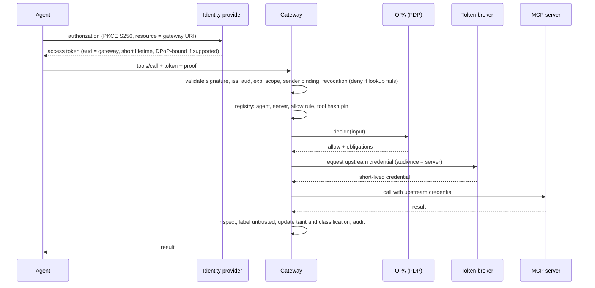

# Authentication and Authorization Design

| | |
|---|---|
| Version | 0.1 (design draft; closes gap A4 in `docs/reviewgap.md`) |
| Depends on | `Plan/functional-spec.md` v0.6 (FR-AUTHN-*, FR-AUTHZ-*, FR-ID-*, FR-POL-*, FR-DATA-*), `Plan/architecture.md` v0.5 (Sections 4.2, 4.6, 5, 6), `docs/mcp-compatibility.md` v0.1, `docs/api-specification.md` v0.1, `controls/catalogue.md` v0.4 (CTL-04..07, CTL-16), `docs/testing/cases.md` v0.5 |
| Status | Design note with **illustrative, unexecuted Rego**. No policy has been run through OPA; syntax and behaviour are unverified (`opa` is not installed in this environment). Identity-provider behaviour is partly search-verified (Keycloak DPoP from 26.4; token exchange V2 internal-to-internal only, see `docs/tech-evaluation.md`). |

## 1. Scope and principles

1. The gateway authenticates every request and asks the policy decision point for every action; **default deny**.
2. Authentication proves *who is calling* (agent identity, human identity); authorization decides *what that identity may do now* on (tool, action class, resource, arguments digest, context).
3. No token passthrough: the gateway never forwards the caller's token to servers; it obtains audience-bound upstream credentials.
4. Tool annotations are never authorization inputs; the action class comes from the registry.
5. Anything that cannot be checked (PDP, registry, revocation list, bundle freshness) results in deny.

## 2. Identities

| Identity | Issued by | Proof | Notes |
|---|---|---|---|
| Agent | Enterprise IdP (OAuth client per agent) | Bearer token, sender-constrained with DPoP or mutual TLS where the IdP supports it | Unique client per agent (FR-ID-1); registration approved by someone other than the requester (FR-ID-2) |
| Human (owner, approver, engineer, auditor) | Enterprise IdP via OIDC | OIDC session with MFA; step-up for approvals (FR-AUTHZ-10) | Roles from role bindings in the registry |
| Platform service | Workload identity (service account federated to cloud identity or secrets manager) | Short-lived credentials | No static keys (NFR-9) |
| MCP server (as callee) | Registry entry | Pinned certificate or JWKS (FR-AUTHN-5) | Never trusted to authenticate callers (A6) |

## 3. Flows

### 3.1 Agent call through the gateway



Notes: the `resource` parameter and protected resource metadata follow the MCP authorization text (see the compatibility matrix); the DPoP step depends on the IdP; without it the fallback is short-lived tokens plus mutual TLS and the test record states the mode (TC-G1).

### 3.2 Human approval of a high-impact call

```mermaid
sequenceDiagram
  participant G as Gateway
  participant P as PDP
  participant API as Management API
  participant H as Approver
  G->>P: decide(call)
  P-->>G: allow with obligation require_approval
  G->>API: create approval (arguments hash, rendered arguments, classification, taint)
  API->>H: notification
  H->>API: open approval (platform-rendered view; agent text shown as untrusted)
  API->>H: step-up authentication challenge
  H->>API: decision (approver differs from requester)
  API->>G: approval bound to arguments hash, expiry
  G->>G: execute only if the arguments hash still matches
```

### 3.3 Just-in-time grant

Request (agent owner) → approver (different person, step-up for high-risk tools) → grant row with mandatory expiry → OPA data updated → expiry removes the grant automatically and writes `grant.expired`.

### 3.4 Credential revocation

Revoke at the IdP and broker → revocation list distributed → gateway checks the list on every request; an unreachable list means deny (FR-ID-7) → `authn.fail` events show attempted use.

## 4. Policy structure (OPA)

| Package (illustrative) | Purpose | Inputs |
|---|---|---|
| `agentic.authz` | Final allow or deny with obligations and reasons | Request input (Section 5) |
| `agentic.registry` | Helper rules over registry data: agent, server, tool status, allow rules | Data from the registry |
| `agentic.grants` | Static and JIT permissions and expiry | Grants data |
| `agentic.taint` | Taint and classification rules (lethal-trifecta check) | Session context |
| `agentic.limits` | Budgets and delegation limits | Counters supplied by the gateway |
| `agentic.mgmt` | Management API actions (who may approve, suspend, change roles) | Actor, action, object, history |

Bundles are built in CI, signed, shipped to gateways and the control plane; every decision logs the bundle hash (FR-POL-2, FR-POL-3).

## 5. Decision input and output (contract)

Input fields (all supplied by the gateway, never by the agent):

| Field | Meaning |
|---|---|
| `tenant` | Tenant ID |
| `agent.id`, `agent.status`, `agent.env` | Agent identity and registry status |
| `server.id`, `server.status`, `server.classification` | Target server |
| `tool.id`, `tool.status`, `tool.action_class`, `tool.classification`, `tool.hash_ok` | Target tool and result of the hash-pin check |
| `resource` | Resource identifier derived from arguments by the tool's declared mapping |
| `args_digest` | Digest of canonical arguments (never the arguments) |
| `session.taint`, `session.max_classification`, `session.call_count` | Run-time context |
| `delegation.chain`, `delegation.depth` | Agent-to-agent chain if any |
| `approval.valid` | Whether an approval bound to `args_digest` exists and is unexpired |
| `now` | Evaluation time |

Output: `allow` (boolean), `reasons` (list of codes for audit), `obligations` (`require_approval`, `redact`, `limit`, `label`). Reason codes are stable identifiers, not free text, so denials can be counted and tested.

## 6. Illustrative policy (unexecuted)

```rego
package agentic.authz

import rego.v1

default allow := false

allow if {
    input.agent.status == "active"
    input.server.status == "approved"
    input.tool.status == "approved"
    input.tool.hash_ok
    agent_server_allowed
    permitted
    not high_impact_without_approval
    not tainted_send_blocked
}

agent_server_allowed if {
    some rule in data.registry.agent_server_allow[input.tenant]
    rule.agent == input.agent.id
    rule.server == input.server.id
}

permitted if {
    some grant in data.grants[input.tenant][input.agent.id]
    grant.tool == input.tool.id
    input.tool.action_class in grant.action_classes
    resource_matches(grant.resource_pattern, input.resource)
    not expired(grant)
}

expired(grant) if {
    grant.expires_at
    time.parse_rfc3339_ns(grant.expires_at) < input.now
}

high_impact if input.tool.action_class == "delete"
high_impact if {
    input.tool.classification in {"Confidential", "Restricted"}
    input.tool.action_class in {"write", "execute"}
}

high_impact_without_approval if {
    high_impact
    not input.approval.valid
}

tainted_send_blocked if {
    input.session.taint == "untrusted_read_of_sensitive"
    input.tool.action_class in {"write", "execute"}
    not input.approval.valid
}

obligations contains "require_approval" if {
    high_impact
    not input.approval.valid
}

reasons contains "no_grant" if not permitted
reasons contains "tool_hash_mismatch" if not input.tool.hash_ok
reasons contains "taint_block" if tainted_send_blocked
```

`resource_matches` is a helper that still has to be defined; the rule set is deliberately incomplete (limits, delegation intersection and classification rules are in sibling packages). Treat the code as pseudocode that shows structure, not as tested policy.

## 7. Policy tests (design)

Each `opa test` case names the cases from `docs/testing/cases.md` it mirrors, so the same scenarios exist at unit level and end to end:

| Unit test | Mirrors |
|---|---|
| Unregistered agent denied; revoked agent denied | TC-F1 |
| Read-only grant cannot write or delete | TC-E1 |
| Unlisted agent-to-server pair denied | TC-C3 |
| Hash mismatch denied regardless of grants | TC-B1 |
| Expired grant denied at the boundary second | TC-E3 |
| High-impact call without a bound approval returns `require_approval` | TC-D4, TC-K3 |
| Tainted session write or send denied | TC-D5 |
| Bundle unavailable or stale (tested in the gateway, not Rego) | TC-Z5 |
| Delegated call never exceeds the delegator's permissions | TC-M2 |

CI runs `opa test` for every change and a shadow comparison of old and new bundles on recorded inputs (FR-POL-4).

## 8. Authorization of management actions

The same engine decides management API actions (`agentic.mgmt`). Rules include: requester differs from approver; Critical overrides need two distinct approvers; suspension and resume by different people unless an emergency policy applies (FR-AUTO-5, FR-AUTO-6); role changes only by the security admin role; no role can alter or delete audit records; every decision is audited with the bundle hash. Step-up authentication age is an input (`actor.mfa_age_seconds`) for approvals and overrides.

## 9. Failure behaviour

| Failure | Behaviour |
|---|---|
| PDP unreachable or bundle stale or unsigned | Deny; readiness fails (FR-AUTHZ-8) |
| Registry unreachable and cache expired | Deny |
| Revocation list unreachable | Deny (FR-ID-7) |
| IdP keys unreachable and cache expired | Deny |
| Broker unreachable | Deny the call (no upstream credential, no fallback to caller's token) |
| Tenant fail-open allowlist (read-only, low-risk tools) | Allow only those tools, flagged in the audit log, reviewed weekly (runbook 9.1) |

## 10. Open items

- Run the sketch through OPA, add the missing helpers and the full test suite (needs `opa` and ADR-6 approval).
- Confirm IdP capability for DPoP or mutual TLS binding, token exchange and resource indicators for the production IdP (spike S2).
- Define the resource-mapping declarations tools must provide so `input.resource` is derived consistently.
- Define reason-code catalogue and obligations schema shared with the gateway and audit schema.
- Step-up authentication mechanics per IdP (gap H4 follow-up).
