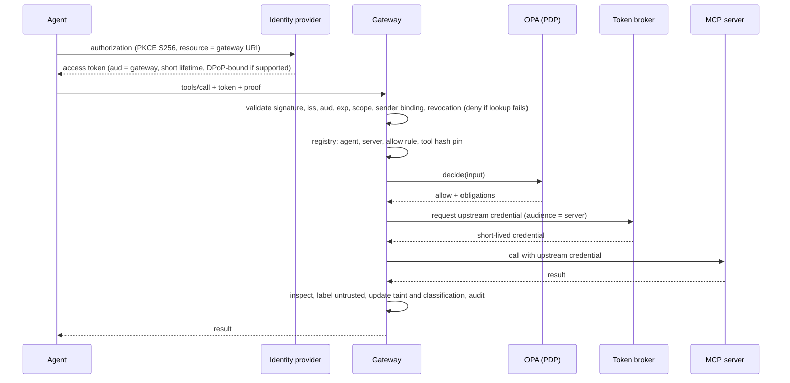
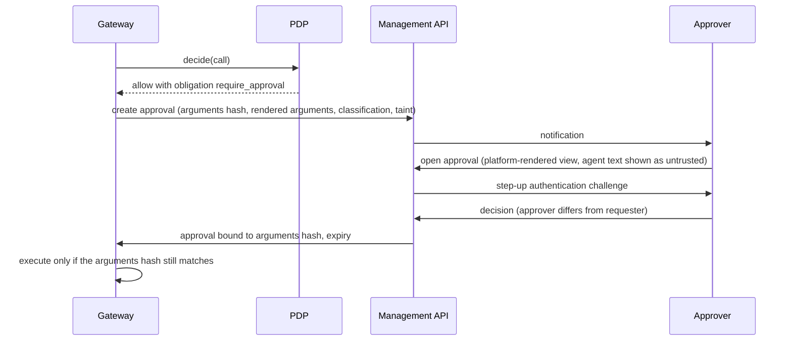

# Authentication and Authorization Design

| | |
|---|---|
| Version | 0.3 (design draft; closes gap A4 in `docs/reviewgap.md`; v0.3 replaces the spike policy of Section 6 by the Phase 1 product policy of WP-1.8; v0.2 ran the Section 6 policy under OPA and fixed the defects found) |
| Depends on | `Plan/functional-spec.md` v0.8 (FR-AUTHN-*, FR-AUTHZ-*, FR-ID-*, FR-POL-*, FR-DATA-*), `Plan/architecture.md` v0.6 (Sections 4.2, 4.6, 5, 6), `docs/mcp-compatibility.md` v0.2, `docs/api-specification.md` v0.4, `controls/catalogue.md` v0.6 (CTL-04..07, CTL-16), `docs/testing/cases.md` v0.5 |
| Status | Design note. The Section 6 policy is the Phase 1 product policy (`policy/rego/authz.rego`, WP-1.8), run under OPA with a decision-table test suite and `opa check --strict` (results in `docs/testing/results/`); it has not run behind a gateway yet (WP-1.9). It covers the Phase 1 rules only (Section 4 packages other than `agentic.authz` are later phases). Identity-provider behaviour is partly search-verified (Keycloak DPoP from 26.4; token exchange V2 internal-to-internal only, see `docs/tech-evaluation.md`); the Phase 1 token validation is in `services/common/.../auth/` (WP-1.10). |

## 1. Scope and principles

1. The gateway authenticates every request and asks the policy decision point for every action; **default deny**.
2. Authentication proves *who is calling* (agent identity, human identity); authorization decides *what that identity may do now* on (tool, action class, resource, arguments digest, context).
3. No token passthrough: the gateway never forwards the caller's token to servers; it obtains audience-bound upstream credentials.
4. Tool annotations are never authorization inputs; the action class comes from the registry.
5. Anything that cannot be checked (PDP, registry, revocation list, bundle freshness) results in deny.

## 2. Identities

| Identity | Issued by | Proof | Notes |
|---|---|---|---|
| Agent | Enterprise IdP (OAuth client per agent) | Bearer token, sender-constrained with DPoP or mutual TLS where the IdP supports it | Unique client per agent (FR-ID-1); registration approved by someone other than the requester (FR-ID-2) |
| Human (owner, approver, engineer, auditor) | Enterprise IdP via OIDC | OIDC session with MFA; step-up for approvals (FR-AUTHZ-10) | Roles from role bindings in the registry |
| Platform service | Workload identity (service account federated to cloud identity or secrets manager) | Short-lived credentials | No static keys (NFR-9) |
| MCP server (as callee) | Registry entry | Pinned certificate or JWKS (FR-AUTHN-5) | Never trusted to authenticate callers (A6) |

## 3. Flows

### 3.1 Agent call through the gateway



Notes: the `resource` parameter and protected resource metadata follow the MCP authorization text (see the compatibility matrix); the DPoP step depends on the IdP; without it the fallback is short-lived tokens plus mutual TLS and the test record states the mode (TC-G1).

### 3.2 Human approval of a high-impact call



### 3.3 Just-in-time grant

Request (agent owner) → approver (different person, step-up for high-risk tools) → grant row with mandatory expiry → OPA data updated → expiry removes the grant automatically and writes `grant.expired`.

### 3.4 Credential revocation

Revoke at the IdP and broker → revocation list distributed → gateway checks the list on every request; an unreachable list means deny (FR-ID-7) → `authn.fail` events show attempted use.

## 4. Policy structure (OPA)

| Package (illustrative) | Purpose | Inputs |
|---|---|---|
| `agentic.authz` | Final allow or deny with obligations and reasons | Request input (Section 5) |
| `agentic.registry` | Helper rules over registry data: agent, server, tool status, allow rules | Data from the registry |
| `agentic.grants` | Static and JIT permissions and expiry | Grants data |
| `agentic.taint` | Taint and classification rules (lethal-trifecta check) | Session context |
| `agentic.limits` | Budgets and delegation limits | Counters supplied by the gateway |
| `agentic.mgmt` | Management API actions (who may approve, suspend, change roles) | Actor, action, object, history |

Bundles are built in CI, signed, shipped to gateways and the control plane; every decision logs the bundle hash (FR-POL-2, FR-POL-3).

## 5. Decision input and output (contract)

Input fields (all supplied by the gateway, never by the agent):

| Field | Meaning |
|---|---|
| `tenant` | Tenant ID |
| `agent.id`, `agent.status`, `agent.env` | Agent identity and registry status |
| `server.id`, `server.status`, `server.classification` | Target server |
| `tool.id`, `tool.status`, `tool.action_class`, `tool.classification`, `tool.hash_ok` | Target tool and result of the hash-pin check |
| `resource` | Resource identifier derived from arguments by the tool's declared mapping |
| `args_digest` | Digest of canonical arguments (never the arguments) |
| `session.taint`, `session.max_classification`, `session.call_count` | Run-time context |
| `delegation.chain`, `delegation.depth` | Agent-to-agent chain if any |
| `approval.valid` | Whether an approval bound to `args_digest` exists and is unexpired |
| `now` | Evaluation time |

Output: `allow` (boolean), `reasons` (list of codes for audit), `obligations` (`require_approval`, `redact`, `limit`, `label`). Reason codes are stable identifiers, not free text, so denials can be counted and tested.

## 6. Policy (Phase 1 product policy, executed under OPA)

The policy below is `policy/rego/authz.rego` with tests in `policy/tests/authz_test.rego`; `check_docs.py` fails if the listing differs from the file. It began as the spike sketch, whose run found three things:

1. **Expiry bug.** The sketch compared `time.parse_rfc3339_ns(grant.expires_at) < input.now`, an integer against a string. Rego orders values of different types by type, so the comparison was always true and every grant with an expiry looked expired: it failed closed, but just-in-time grants could never work. The fix parses both sides and treats the boundary second as expired (`<=`).
2. **Missing helper.** `resource_matches` is now defined (`*` matches anything, a trailing `*` matches a prefix, otherwise exact).
3. **Slow lookup.** The agent-to-server list was scanned linearly. Keyed by tenant, agent and server it evaluates about 20 times faster (Section 6.1).

WP-1.8 then made the policy always return one decision object (`allow`, stable `reasons`, `obligations`, `policy_hash`), validated every input field and its type (a missing or mistyped field denies), added bundle presence, validity and freshness checks, refused resources with a `..` segment (a prefix pattern would otherwise accept `docs/../finance`), and closed the opposite of the expiry bug: an unparsable expiry and a just-in-time grant without expiry are never live.


```rego
package agentic.authz

import rego.v1

# Product policy for Phase 1 (WP-1.8). Contract: docs/authn-authz-design.md Sections 4 and 5.
#
# Query data.agentic.authz.decision. It always returns {allow, reasons, obligations, policy_hash}:
#   - allow is true only when every positive condition holds (default deny);
#   - reasons are stable codes, empty when allowed and never empty when denied (tested);
#   - obligations carry require_approval and the like;
#   - policy_hash is the hash of the bundle that produced the decision (FR-POL-2), "" if unknown.
#
# Fail closed: a missing or mistyped input field, a missing, malformed or stale bundle, an unparsable
# grant expiry, all deny. Data shape:
#   data.bundle   = {hash, generated_at, max_age_seconds}      (written by policy/build_bundle.py and the publisher)
#   data.registry.agent_server_allow[tenant][agent][server] = true
#   data.grants[tenant][agent] = [{tool, action_classes, resource_pattern?, expires_at?, grant_type?}, ...]

default allow := false

allow if {
	input_valid
	bundle_fresh
	input.agent.status == "active"
	input.server.status == "approved"
	input.tool.status == "approved"
	input.tool.hash_ok == true
	agent_server_allowed
	permitted
	not approval_needed
	not tainted_send_blocked
}

decision := {
	"allow": allow,
	"reasons": sort([r | some r in reasons]),
	"obligations": sort([o | some o in obligations]),
	"policy_hash": policy_hash,
}

policy_hash := data.bundle.hash if is_string(data.bundle.hash)

default policy_hash := ""

# ---------------------------------------------------------------- input validation

action_classes := {"read", "write", "execute", "delete"}

input_valid if {
	non_empty_string(input.tenant)
	non_empty_string(input.agent.id)
	is_string(input.agent.status)
	non_empty_string(input.server.id)
	is_string(input.server.status)
	non_empty_string(input.tool.id)
	is_string(input.tool.status)
	input.tool.action_class in action_classes
	is_boolean(input.tool.hash_ok)
	is_string(input.resource)
	not path_traversal(input.resource)
	non_empty_string(input.args_digest)
	is_boolean(input.approval.valid)
	valid_time(input.now)
}

non_empty_string(x) if {
	is_string(x)
	x != ""
}

valid_time(t) if {
	is_string(t)
	is_number(time.parse_rfc3339_ns(t))
}

# A resource containing a parent-directory segment is refused outright: a prefix pattern such as
# "docs/*" would otherwise accept "docs/../finance/q3".
path_traversal(resource) if {
	some seg in split(replace(resource, "\\", "/"), "/")
	seg == ".."
}

# ---------------------------------------------------------------- bundle freshness (FR-AUTHZ-8, CTL-16)

bundle_present if is_object(data.bundle)

bundle_valid if {
	bundle_present
	is_string(data.bundle.hash)
	regex.match(`^[0-9a-f]{64}$`, data.bundle.hash)
	is_number(data.bundle.max_age_seconds)
	data.bundle.max_age_seconds > 0
	is_number(time.parse_rfc3339_ns(data.bundle.generated_at))
}

# Age in seconds. A bundle dated more than 60 s in the future is invalid (clock fault), not fresh.
bundle_age_seconds := (time.parse_rfc3339_ns(input.now) - time.parse_rfc3339_ns(data.bundle.generated_at)) / 1e9 if {
	bundle_valid
	valid_time(input.now)
}

bundle_fresh if {
	bundle_age_seconds >= -60
	bundle_age_seconds < data.bundle.max_age_seconds
}

# ---------------------------------------------------------------- registry and grants

agent_server_allowed if data.registry.agent_server_allow[input.tenant][input.agent.id][input.server.id] == true

permitted if {
	some grant in data.grants[input.tenant][input.agent.id]
	grant.tool == input.tool.id
	input.tool.action_class in grant.action_classes
	resource_matches(object.get(grant, "resource_pattern", "*"), input.resource)
	grant_live(grant)
}

# A static grant without expiry is live; any expiry must parse and lie strictly in the future (the boundary
# second is expired). A just-in-time grant without expiry, or an unparsable expiry, is never live.
grant_live(grant) if {
	object.get(grant, "expires_at", null) == null
	object.get(grant, "grant_type", "static") == "static"
}

grant_live(grant) if {
	time.parse_rfc3339_ns(grant.expires_at) > time.parse_rfc3339_ns(input.now)
}

# "*" matches anything; a trailing "*" matches a prefix; otherwise exact.
resource_matches(pattern, _) if pattern == "*"

resource_matches(pattern, resource) if {
	pattern != "*"
	endswith(pattern, "*")
	startswith(resource, trim_suffix(pattern, "*"))
}

resource_matches(pattern, resource) if {
	not endswith(pattern, "*")
	pattern == resource
}

# ---------------------------------------------------------------- impact and taint

high_impact if input.tool.action_class == "delete"

# Write and execute are high impact unless the tool is known to be Public or Internal; an unknown
# classification counts as sensitive.
high_impact if {
	input.tool.action_class in {"write", "execute"}
	not low_classification
}

low_classification if input.tool.classification in {"Public", "Internal"}

approval_needed if {
	high_impact
	input.approval.valid != true
}

tainted_send_blocked if {
	input.session.taint == "untrusted_read_of_sensitive"
	input.tool.action_class in {"write", "execute"}
	input.approval.valid != true
}

# ---------------------------------------------------------------- obligations and reasons

obligations contains "require_approval" if {
	input_valid
	approval_needed
}

reasons contains "input_invalid" if not input_valid

reasons contains "bundle_missing" if not bundle_present

reasons contains "bundle_invalid" if {
	bundle_present
	not bundle_valid
}

reasons contains "bundle_invalid" if {
	bundle_valid
	valid_time(input.now)
	bundle_age_seconds < -60
}

reasons contains "bundle_stale" if {
	bundle_valid
	valid_time(input.now)
	bundle_age_seconds >= data.bundle.max_age_seconds
}

# Facts about the request are only reported when the input is well formed.
reasons contains "agent_inactive" if {
	input_valid
	input.agent.status != "active"
}

reasons contains "server_not_approved" if {
	input_valid
	input.server.status != "approved"
}

reasons contains "tool_not_approved" if {
	input_valid
	input.tool.status != "approved"
}

reasons contains "tool_hash_mismatch" if {
	input_valid
	input.tool.hash_ok != true
}

reasons contains "agent_server_not_allowed" if {
	input_valid
	not agent_server_allowed
}

reasons contains "no_grant" if {
	input_valid
	not permitted
}

reasons contains "approval_required" if {
	input_valid
	approval_needed
}

reasons contains "taint_block" if {
	input_valid
	tainted_send_blocked
}
```

The rule set is deliberately incomplete (limits, delegation intersection and classification rules are in sibling packages). The listing above is the executed file.

### 6.1 Evaluation time (spike S3, indicative)

Measured with `opa bench` on the single query `data.agentic.authz.allow`, in-process, in a container on a laptop, with 100,000 grants (2,000 agents with 50 grants each) and 2,000 allow-list entries. It excludes the network hop to a sidecar, bundle loading and the decision cache, so it is not the gateway's added latency (NFR-1 is p95 25 ms for the whole deterministic path).

| Agent-to-server data | Median | p95 | p99 |
|---|---|---|---|
| List scanned linearly (the sketch) | 4.1 ms | 6.1 ms | 12.3 ms |
| Keyed by tenant, agent and server (adopted) | 0.2 ms | 0.5 ms | 0.7 ms |

The data shape decides the cost. Grants were already looked up by tenant and agent. Neither run says anything about larger data, concurrency or a loaded host; the S3 spike still needs realistic data sizes from a customer and a load profile.

## 7. Policy tests (design)

Each `opa test` case names the cases from `docs/testing/cases.md` it mirrors, so the same scenarios exist at unit level and end to end:

| Unit test | Mirrors |
|---|---|
| Unregistered agent denied; revoked agent denied | TC-F1 |
| Read-only grant cannot write or delete | TC-E1 |
| Unlisted agent-to-server pair denied | TC-C3 |
| Hash mismatch denied regardless of grants | TC-B1 |
| Expired grant denied at the boundary second | TC-E3 |
| High-impact call without a bound approval returns `require_approval` | TC-D4, TC-K3 |
| Tainted session write or send denied | TC-D5 |
| Bundle unavailable or stale (tested in the gateway, not Rego) | TC-Z5 |
| Delegated call never exceeds the delegator's permissions | TC-M2 |

CI runs `opa test` for every change and a shadow comparison of old and new bundles on recorded inputs (FR-POL-4).

## 8. Authorization of management actions

The same engine decides management API actions (`agentic.mgmt`). Rules include: requester differs from approver; Critical overrides need two distinct approvers; suspension and resume by different people unless an emergency policy applies (FR-AUTO-5, FR-AUTO-6); role changes only by the security admin role; no role can alter or delete audit records; every decision is audited with the bundle hash. Step-up authentication age is an input (`actor.mfa_age_seconds`) for approvals and overrides.

## 9. Failure behaviour

| Failure | Behaviour |
|---|---|
| PDP unreachable or bundle stale or unsigned | Deny; readiness fails (FR-AUTHZ-8) |
| Registry unreachable and cache expired | Deny |
| Revocation list unreachable | Deny (FR-ID-7) |
| IdP keys unreachable and cache expired | Deny |
| Broker unreachable | Deny the call (no upstream credential, no fallback to caller's token) |
| Tenant fail-open allowlist (read-only, low-risk tools) | Allow only those tools, flagged in the audit log, reviewed weekly (runbook 9.1) |

## 10. Open items

- Extend the executed policy to the full rule set and the remaining Section 7 cases (TC-Z5 and TC-M2 are tested in the gateway or later); measure with realistic data sizes and concurrency for spike S3; confirm the OPA licence (ADR-6 condition).
- Confirm IdP capability for DPoP or mutual TLS binding, token exchange and resource indicators for the production IdP (spike S2).
- Define the resource-mapping declarations tools must provide so `input.resource` is derived consistently.
- Define reason-code catalogue and obligations schema shared with the gateway and audit schema.
- Step-up authentication mechanics per IdP (gap H4 follow-up).
