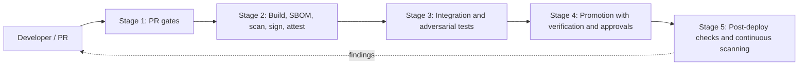

# CI/CD Security Pipeline: AgenticSecCtl

| | |
|---|---|
| Version | 0.3 (design draft; the product pipeline is a template, only the document checks are wired up) |
| Depends on | `Plan/functional-spec.md` v0.5 (NFR-9, FR-SCAN-5, FR-SUP-1..4, FR-POL-1..4), `Plan/architecture.md` v0.4 (Sections 8, 10), `Plan/threat-model.md` v0.4 (threats L, X8), `docs/testing/cases.md` v0.4 (TC-L1..L3, TC-X6), `docs/runbooks/operational-runbook.md` v0.3 (Section 6 change management), `controls/catalogue.md` v0.3 (CTL-16, CTL-17, CTL-27) |
| Platform | GitHub Actions (decision recorded in this document; no remote repository is configured yet) |
| Status | Untested on GitHub: no workflow in this repository has run (no remote). Syntax of the workflow, Dependabot and template files was validated with PyYAML, and the template's job shape was checked (`scripts/validate_yaml.py`, 2026-11-22). The `actions/checkout` pin was read from the public GitHub API (release v7.0.1 and the commit its tag points to) via a page-fetching assistant and must be re-verified before the first run. All other third-party action names, versions and commit SHAs remain **not verified** (placeholders `TBD_PIN_SHA` in the template). |

## 1. Purpose and scope

The pipeline keeps the platform itself from becoming the weakest link (threat X8) and keeps vulnerable, unsigned or tampered artifacts out of the platform and the server fleet (threat L). It implements NFR-9, CTL-27 (secure development and change management) and CTL-17 (supply-chain security), and gives the policy lifecycle of CTL-16 its automation.

In scope: source checks, build, test, scan, sign, attest, promote, deploy, post-deploy verification and the security of the pipeline itself. Out of scope: runtime protection of agents (the product), organisational change approval boards, and cloud account baselines.

## 2. Principles

1. **Fail closed.** A failed or missing gate blocks merge, build, signing or promotion. Scanner outage means no release.
2. **Least privilege everywhere.** Workflow tokens default to read-only; each job requests only what it needs; deployment credentials are separate from build credentials.
3. **No long-lived secrets in CI.** Cloud access uses short-lived federated identity (OIDC) where the target supports it **[VERIFY per cloud]**; signing uses keyless identity or a key held in a managed KMS, never a file in the repo.
4. **Immutable, attested artifacts.** Images are referenced by digest, signed, with an SBOM and provenance attached. Deployment verifies them again (admission control, FR-SUP-1).
5. **Pin what runs.** Third-party actions are pinned to a full commit SHA; base images by digest; dependencies by lockfile with hashes.
6. **Separation of duties.** Author, reviewer and deployer are different people for security-relevant paths (policy, migrations, deploy, controls).
7. **Evidence by default.** Every run stores the artefacts an auditor will ask for (Section 9), linked to controls.
8. **The pipeline is attack surface.** Section 8 lists pipeline-specific threats and mitigations.

## 3. Pipeline overview

| Stage | Trigger | Runs on | Blocks |
|---|---|---|---|
| 1 PR gates | Pull request, push to protected branches | Hosted or ephemeral runners, no secrets | Merge |
| 2 Build and supply chain | Merge to main, release tag | Ephemeral runners, signing identity | Artifact publication |
| 3 Integration and adversarial | After stage 2; nightly for long jobs | Isolated environment, hostile fixtures | Promotion to staging |
| 4 Promotion | Manual/automatic with approvals | Environment-scoped credentials | Deployment |
| 5 Post-deploy and continuous | After deploy; schedule | Scheduled jobs | Alerts, rollback, new findings |

## 4. Gates by stage

Candidate tools are listed for orientation only; none has been verified against current documentation **[VERIFY]**. Thresholds marked "to be set" need a decision from security engineering before enforcement.

### Stage 1: pull request gates

| Gate | Purpose | Candidate tooling **[VERIFY]** | Fails when | Requirement / control / test |
|---|---|---|---|---|
| G1.1 Document and traceability checks | Requirements, controls, tests, versions and generated files stay consistent | `scripts/check_docs.py`, regeneration of generated files | Any inconsistency | Repo process; CLAUDE.md |
| G1.2 Format and lint | Code quality baseline | Ruff/mypy for Python, ESLint/tsc for web | Any error | CTL-27 |
| G1.3 Unit tests and policy tests | Behavioural regression; Rego policy correctness | pytest, `opa test` | Any failing test | FR-POL-1, CTL-16 |
| G1.4 Secret scanning | No credentials in code or history of the PR | gitleaks or trufflehog style scanner | Any verified or high-confidence secret | CTL-27, TC-L3 |
| G1.5 Static analysis (SAST) | Injection, unsafe deserialization, SSRF patterns, crypto misuse | Semgrep, Bandit, CodeQL | Findings at or above threshold (to be set) | CTL-27, CTL-11 |
| G1.6 Dependency and licence review | Known-vulnerable or disallowed-licence dependencies introduced by the PR | Dependency review action, OSV-Scanner, pip-audit/npm audit | Critical/High vulnerabilities with fix available (threshold to be set); disallowed licence | FR-SCAN-5, CTL-17, TC-L3 |
| G1.7 IaC and manifest scan | Helm, K8s and Compose misconfiguration (privileged pods, missing limits, open egress) | Trivy config, Checkov, kube-linter, Kyverno CLI | Violations of the admission baseline | FR-EXEC-1, CTL-11 |
| G1.8 Dockerfile and image-baseline lint | Non-root, pinned base digest, no secrets in layers | hadolint, Dockerfile policy | Any violation | FR-SUP-1 |
| G1.9 Policy diff review | A policy change shows its effect (new allows) before merge | OPA diff in shadow-comparison form (custom script) | New allow not acknowledged by a security reviewer | FR-POL-4, CTL-16, TC-X6 |
| G1.10 Pipeline self-check | Workflow files obey pipeline rules (pins, permissions) | `scripts/check_docs.py` workflow lint | Unpinned action without a recorded waiver; missing `permissions` | Section 8 |

### Stage 2: build and supply chain

| Gate | Purpose | Candidate tooling **[VERIFY]** | Fails when | Requirement / control / test |
|---|---|---|---|---|
| G2.1 Reproducible build | Same source gives the same artifact digest where practical | Pinned toolchain, locked dependencies, hermetic build | Non-determinism detected in the check build (target; may be advisory first) | CTL-17 |
| G2.2 SBOM generation | Inventory of components per image | Syft, CycloneDX or SPDX output | SBOM missing or empty | FR-SCAN-5 |
| G2.3 Image vulnerability scan | Known vulnerabilities in OS and language layers | Trivy, Grype | Critical/High above policy (to be set); scanner unavailable | FR-SCAN-5, TC-L3 |
| G2.4 Malware and secret scan of artifacts | Final image contents | Scanner of choice | Any finding | CTL-17 |
| G2.5 Signing | Prove origin and integrity | cosign keyless or KMS-held key | Signing fails | FR-SUP-1, TC-L4 |
| G2.6 Provenance attestation | Record how the artifact was built | SLSA-style provenance, GitHub artifact attestations | Attestation missing | CTL-17 |
| G2.7 Publish by digest | Reference immutable digests only | Registry push, digest output | Tag-only reference produced | FR-SUP-1 |

### Stage 3: integration and adversarial testing

| Gate | Purpose | Tooling | Fails when | Requirement / control / test |
|---|---|---|---|---|
| G3.1 End-to-end suite | Product behaviour with hostile and benign MCP fixtures on an isolated Compose network | `deploy/compose` e2e profile, pytest | Any MVP case fails (cases Section 20) | AC-1..AC-9, `docs/testing/cases.md` |
| G3.2 Authorization and negative tests | Deny-by-default, SoD, SSRF, fail-closed | Cases TC-E1, TC-E4, TC-H1..H4, TC-Z5 | Any failure | CTL-06, CTL-08, CTL-24 |
| G3.3 Fuzzing (scheduled) | Importer, schema and JSON-RPC framing | Case TC-Z1, TC-Z2 harness | Crash, hang, bypass | CTL-11 |
| G3.4 Supply-chain canary | Prove the gates actually fail | A branch that adds a planted vulnerable dependency and a fake secret (TC-L3) | Gate does not fail on the canary | TC-L3, CTL-17 |
| G3.5 Performance check | Added gateway latency stays within budget | Load test (NFR-1 method) | p95 > 25 ms or p99 > 60 ms on reference setup | NFR-1 |

### Stage 4: promotion and deployment

| Gate | Purpose | Fails when | Requirement / control / test |
|---|---|---|---|
| G4.1 Signature and provenance verification | Verify signer identity, digest and attestation before any environment | Verification fails or identity does not match the expected workflow | FR-SUP-1, TC-L4 |
| G4.2 Admission control | Cluster rejects unsigned, tag-only or non-compliant workloads | Admission denies | TC-L4 |
| G4.3 Environment protection | Required reviewers (deployer is not the author), wait timers, branch restrictions | Approval missing | SoD-1, CTL-23 |
| G4.4 Staged rollout | Dev, staging, canary pods, then wider; policy bundles first in shadow mode (runbook 7.1) | Deny-rate, latency or error metrics beyond rollback triggers (runbook Section 6) | CTL-16, CTL-24 |
| G4.5 Database migration safety | Expand/contract compatibility with the running version | Backward-incompatible migration | Runbook Section 6 |
| G4.6 Policy bundle signing | Gateways accept only signed, current bundles | Signing key not used or bundle unsigned | FR-POL-3 |

### Stage 5: post-deploy and continuous

| Check | Purpose | Cadence | Requirement / control / test |
|---|---|---|---|
| Smoke tests | Fail-closed and basic authorization in the target environment | After each deploy | TC-F1, TC-E1, TC-Z5 |
| Deployed-vs-signed comparison | Detect running images that differ from the approved digest | Hourly or continuous | CTL-17 |
| SBOM re-scan | New vulnerabilities in already deployed components | Daily | FR-SCAN-5, CTL-17 |
| Dependency and base-image updates | Keep pins current | Weekly proposals via automated PRs | CTL-27 |
| Penetration test and red-team regression | Gateway and control plane | Per phase and annually (to be set) | TC-X8, CTL-27 |
| Audit chain verification after release | Release did not damage audit integrity | After each deploy | TC-Z6, CTL-13 |

## 5. Repository and branch controls

- Protected `main`: required status checks (all Stage 1 gates), no force-push, linear history, signed commits **[VERIFY availability for chosen setup]**, branch deletion restricted.
- Review: at least one reviewer who is not the author; two reviewers for `policy/`, `db/migrations/`, `deploy/`, `controls/`, `.github/`, and `Plan/functional-spec.md` requirements changes. Enforced through code owners **[names to be assigned]**.
- Dismiss stale approvals on new pushes; no bypass for administrators except break-glass with an audit record (CTL-23).
- Workflow files change only through reviewed PRs; the pipeline self-check (G1.10) runs on them.
- Secrets are stored per environment, not per repository where possible; none are exposed to forks.

## 6. Pipeline identity and secrets

| Item | Rule |
|---|---|
| Workflow token | `permissions: contents: read` at workflow level; jobs grant extra scopes explicitly (for example `id-token: write` only in signing/deploy jobs) |
| Cloud/registry access | Short-lived federated identity; separate roles for build/push versus deploy; deploy role restricted to the environment and branch/tag |
| Signing | Keyless identity bound to the build workflow, or a KMS key; verifiers check the expected workflow identity, not just a valid signature |
| Policy-bundle signing key | Held in a managed KMS/HSM; usable only by the release job; rotation per runbook 7.5 |
| Third-party credentials | Stored as environment secrets; rotated; never echoed; masked in logs |
| Pull requests from forks | Run with no secrets and read-only token; never use `pull_request_target` to execute fork code |

## 7. Exceptions and waivers

Exceptions are rare, recorded and expire.

| Rule | Detail |
|---|---|
| Waiver record | ID (W-nnn), what is waived, reason, compensating control, owner, approvers (two for security gates), expiry date |
| Allowed | Time-boxed waiver of a scanner finding (for example not exploitable, fix not available); temporary use of a tag instead of a SHA when a SHA cannot be obtained |
| Never allowed | Skipping signing, skipping secret scanning, disabling admission control, reusing production secrets in non-production |
| Review | Expired waivers fail the pipeline; monthly review of open waivers |

Waivers (none active):

| ID | Item | Reason | Compensating control | Expires |
|---|---|---|---|---|
| W-001 | `actions/checkout` referenced by version tag | Commit SHA could not be verified | — | **Retired 2026-11-22:** workflow now pins the commit SHA of release v7.0.1 |

## 8. Threats to the pipeline itself

| Threat | Example | Mitigation |
|---|---|---|
| Malicious or compromised third-party action | Maintainer pushes a new tag with exfiltration code | Pin to full commit SHA; allowlist actions; automated update PRs reviewed; prefer plain scripts for simple steps |
| Workflow injection | Untrusted PR title or branch name interpolated into a shell command | Pass inputs through environment variables, never inline `${{ }}` in `run:` for untrusted data; no `pull_request_target` on fork code |
| Secret exfiltration from a PR | Fork PR prints secrets | No secrets to forks; read-only token; environment secrets with required reviewers |
| Poisoned cache or artifact | Cache restored from an untrusted branch | Scope caches by branch/lockfile hash; do not restore caches across trust levels; verify artifact digests |
| Compromised runner | Persistent self-hosted runner leaks between jobs | Ephemeral runners, no reuse; network egress restricted where possible |
| Dependency confusion and typosquatting | Internal package name published publicly | Private index priority, lockfiles with hashes, name checks (FR-SUP-2) |
| Tampered release artifact | Image replaced after signing | Deploy by digest; admission verifies signature and workflow identity; deployed-vs-signed comparison |
| Insider changes pipeline to skip gates | Removes a required check | Code owners on `.github/`, branch protection, pipeline self-check, audit of repository settings |
| Stolen deploy credentials | Long-lived cloud key leaked | Federated short-lived credentials, environment-scoped roles, no long-lived keys |

## 9. Evidence produced per run

| Evidence | Produced by | Retention | Used for |
|---|---|---|---|
| Test and gate results (JUnit/summary) | All stages | Per retention class (default aligned with NFR-6 once decided) | CTL-27, audits |
| SBOM per image | G2.2 | With the artifact | FR-SCAN-5, incident response (PB-09) |
| Vulnerability and secret scan reports | G1.4, G1.6, G2.3 | Same | CTL-17 |
| Signature and provenance attestations | G2.5, G2.6 | Same | FR-SUP-1 |
| Approval records (reviewers, environment approvals) | GitHub and environment protection | Same | SoD, FR-COMP-4 |
| Policy bundle hash and diff report | G1.9, G4.6 | Same | FR-POL-2, CTL-16 |
| Deployment record: digest, environment, approver, time | Stage 4 | Same | Change management, incident timeline |
| Waiver records | Section 7 | Until expiry plus retention | Governance |

Evidence is linked to controls in `controls/catalogue.md` and consumed by the compliance evidence packs (FR-COMP-4, CTL-25).

## 10. Rollout by phase

| Phase | Pipeline scope |
|---|---|
| Today (design stage) | Document consistency and generated-file freshness (`.github/workflows/docs-check.yml`); Dependabot proposals for workflow action updates (`.github/dependabot.yml`) |
| P1 MVP | Stage 1 gates G1.1..G1.10 on the first code; Stage 2 build, SBOM, scan, signing for the first images; Compose e2e (G3.1, G3.2) for MVP cases |
| P2 | Stage 3 fuzz and performance, Stage 4 environments with verification and admission, policy bundle signing |
| P3 | Supply-chain intake automation for third-party servers, evidence pack automation |
| P4 | Provenance enforcement for server images in the fleet, continuous deployed-vs-signed comparison |
| P5 | Multi-cloud deployment targets, regional release gates, external pen-test cadence |

Signing and admission of the platform's own images are required from Phase 2 (FR-SUP-1, retagged from Phase 4 in spec v0.4 to match this pipeline); the server-fleet equivalent is FR-SUP-4 in Phase 4. This closes the phase conflict recorded as F2 in the roadmap.

The template for the product gates is `docs/ci-templates/product-security-gates.yml`. It is not an active workflow: it sits outside `.github/workflows/`, its action pins are `TBD`, and it must not be copied into place until each action has been verified and pinned.

## 11. Open items and unverified claims

- Verify and pin every third-party action (names, versions, commit SHAs, permissions), plus tool licences (**[VERIFY]**).
- Decide thresholds: vulnerability severities that fail builds, SAST severity threshold, patch deadlines (CTL-27 parameter "to be set").
- Decide signing approach (keyless vs KMS key) and registry; confirm availability of artifact attestations and signed-commit enforcement for the chosen hosting plan **[VERIFY]**.
- Name the code owners and reviewer teams; configure branch protection and environments (requires a remote repository).
- Reproducible builds are a goal; achievability depends on the build toolchain.
- None of the workflows has been run; the pipeline self-check only validates pins and permissions with a text check, not workflow semantics (use a workflow linter once available **[VERIFY]**).
