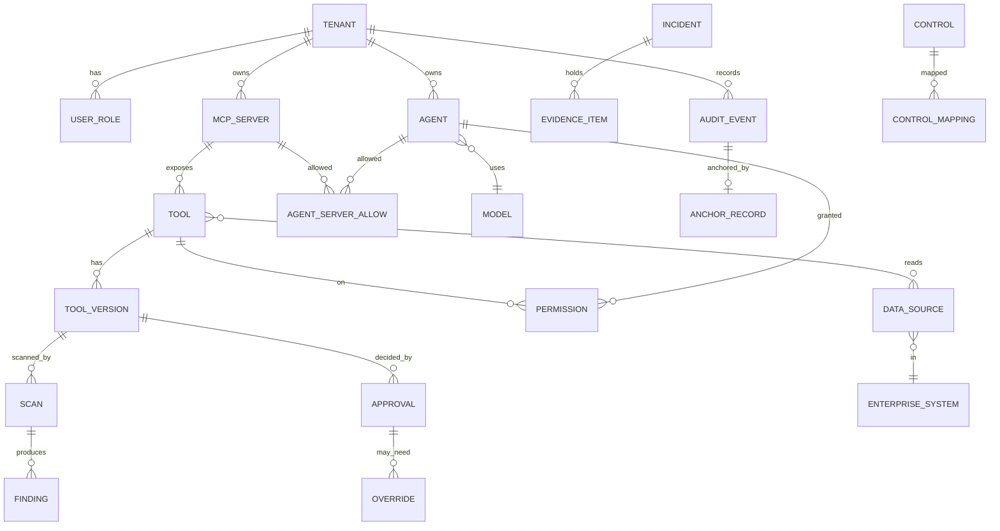

# Data Model: AgenticSecCtl

| | |
|---|---|
| Version | 0.1 (design draft; closes gap A2 in `docs/reviewgap.md`) |
| Depends on | `Plan/functional-spec.md` v0.6 (Section 7 entities, FR-DRIFT-1, FR-AUD-*, FR-DATA-*, FR-ADM-*), `Plan/architecture.md` v0.5 (Sections 4, 7, 12), `docs/deployment-architecture.md` v0.3 (Section 6), `controls/catalogue.md` v0.4 (CTL-03, CTL-13, CTL-22, CTL-29) |
| Status | Logical model with illustrative PostgreSQL constraints. **Not validated, not executed**: no SQL has been run and no migration exists. The tenancy assumption is ADR-4 *proposed* (shared multi-tenant with row-level security), pending approval; column and table names may change at schema freeze. |

## 1. Principles

1. **Tenant ID on every tenant-owned row**, enforced by PostgreSQL row-level security (RLS) as a second line behind application filters (FR-RT-8, TC-I3).
2. **Immutability where trust depends on it:** approved tool versions and audit events cannot be updated or deleted by application roles (FR-DRIFT-1, FR-AUD-1).
3. **Store digests and redacted excerpts, not raw payloads**; raw evidence lives in the evidence vault, referenced by object ID (FR-AUD-3).
4. **State changes are events:** every status change writes an audit event in the same transaction (outbox pattern), so the registry and audit trail cannot diverge.
5. **No secrets in the database:** credentials are references to the secrets manager (NFR-9).
6. **Time in UTC with timezone**, generated by the database for audit events; clocks synchronised.

## 2. Entity overview



## 3. Tables

Types are indicative. `tenant_id uuid not null` is on every table below unless stated. Common columns: `id uuid primary key`, `created_at timestamptz not null default now()`, `created_by` (user or service identity).

### 3.1 Tenancy and access

| Table | Key columns | Notes |
|---|---|---|
| `tenants` | name, region, retention_policy_id, data_residency, status | Not tenant-scoped itself; read access limited to platform admin roles |
| `users` | external_subject (from IdP), display_name, status | Subject is the IdP identity; no passwords stored |
| `role_bindings` | user_id, role (viewer, agent_owner, server_owner, security_engineer, approver, security_admin, auditor, incident_responder, platform_operator), scope (tenant or resource), expires_at | Roles from spec Section 2; separation-of-duties enforced in service logic and constraints (Section 6) |
| `classification_levels` | name, rank, description | Default levels Public, Internal, Confidential, Restricted (proposed); `unique (tenant_id, rank)` (FR-DATA-1) |

### 3.2 Inventory

| Table | Key columns | Notes |
|---|---|---|
| `agents` | name, owner_user_id, environment, criticality, model_id, identity_ref, status (pending, active, suspended, retired), approved_by | `identity_ref` points to the IdP client; unique per tenant and name |
| `models` | provider, identifier, version, endpoint_ref, status | Approved model pinning (FR-MOD-1) |
| `mcp_servers` | namespace, url, transport, owner_user_id, environment, criticality, trust_tier, tls_pin or jwks_ref, egress_allowlist (child table), status (pending, approved, quarantined, retired), classification_level_id | `unique (tenant_id, namespace)`; URL validated by the SSRF guard before insert |
| `server_egress_allow` | server_id, destination, port, approved_by, expires_at | Per-server egress allowlist (FR-RT-7, FR-SSRF-5) |
| `tools` | server_id, name, status (pending, approved, quarantined, rejected), action_class (read, write, execute, delete), classification_level_id, current_version_id | `unique (server_id, name)`; action class set at approval, never from annotations |
| `tool_versions` | tool_id, version_no, canonical_json (jsonb), sha256 (bytea), scan_id, approved_by, approved_at | **Immutable** (Section 5); `unique (tool_id, version_no)`; `unique (tool_id, sha256)` |
| `data_sources`, `enterprise_systems`, `graph_edges` | name, type, classification_level_id; edge (from_type, from_id, to_type, to_id) | Relationship graph Agent, Model, Server, Tool, Data Source, System (FR-INV-6) |
| `agent_server_allow` | agent_id, server_id, approved_by | Allowlist (FR-AUTHZ-2) |

### 3.3 Authorization

| Table | Key columns | Notes |
|---|---|---|
| `permissions` | agent_id, tool_id, action_classes (array), resource_pattern, grant_type (static, jit), expires_at, requested_by, approved_by, reason | JIT rows require `expires_at`; `requested_by <> approved_by` (FR-AUTHZ-4) |
| `approvals` | subject_type (tool_version, agent, grant, call), subject_id, arguments_hash (for calls), requested_by, status, decided_by, decided_at, expires_at | `requested_by <> decided_by`; for call approvals the hash binds the exact arguments (FR-AUTHZ-5) |
| `overrides` | approval_id, finding_id, justification, expires_at | Two distinct approver rows required before an override takes effect (SoD-2) |
| `override_approvers` | override_id, approver_user_id | `unique (override_id, approver_user_id)`; effect requires count of 2 |

### 3.4 Security data

| Table | Key columns | Notes |
|---|---|---|
| `rule_sets` | version, content_hash, published_at | Scans record the rule-set version (FR-SCAN-2) |
| `scans` | tool_version_id or server_id, rule_set_id, risk_score, started_at, finished_at, status | |
| `findings` | scan_id, rule_id, severity (critical, high, medium, low, info), location, evidence_excerpt, confidence, status (open, accepted, fixed), waiver_expires_at | Evidence excerpts are short and redacted |
| `incidents` | severity, status, opened_by, commander, summary | |
| `incident_assets` | incident_id, asset_type, asset_id | Affected agents, servers, tools |
| `evidence_items` | incident_id, object_ref, sha256, collected_by, collected_at, legal_hold | Object stored in the vault; chain-of-custody columns |
| `sessions` (runtime summary, optional) | agent_id, started_at, taint_state, highest_classification, call_count | Short-lived state is kept in Redis from Phase 2; the table holds summaries for investigation |

### 3.5 Audit

| Table | Key columns | Notes |
|---|---|---|
| `audit_events` | seq (bigint, per tenant), tenant_id, occurred_at, event_type (vocabulary in `Plan/architecture.md` Section 4.8), actor, subject_type, subject_id, decision, policy_hash, input_digest, payload_digest, redacted_excerpt, prev_hash, hash | **Insert-only**; `unique (tenant_id, seq)`; `hash = SHA-256(prev_hash ‖ canonical(event))` |
| `anchor_records` | tenant_id, seq_from, seq_to, head_hash, anchored_at, anchor_ref | Written by the audit service only; the anchor itself lives in the external store (FR-AUD-4) |
| `outbox` | event payload, state | Source for SIEM export and the audit service; processed in order |

### 3.6 Governance

| Table | Key columns | Notes |
|---|---|---|
| `controls`, `control_mappings` | control_id (CTL-nn), framework, item, status_type (mandatory, guidance, voluntary), reviewed_by, reviewed_at | Loaded from `controls/catalogue.yaml` and the compliance matrix; not tenant-scoped |
| `evidence_packs` | control_id, period, object_ref, sha256, generated_by | Signed and hash-listed (FR-COMP-4) |
| `retention_policies` | data_class, hot_days, cold_days, legal_hold_allowed | Defaults per spec NFR-6 |
| `config_versions` | scope, content_hash, applied_by, applied_at | Declarative configuration history (FR-ADM-1) |

## 4. Enumerations

Agent status: pending, active, suspended, retired. Server and tool status: pending, approved, quarantined, rejected (servers also retired). Action class: read, write, execute, delete. Finding severity: critical, high, medium, low, info. Grant type: static, jit. Approval status: pending, approved, rejected, expired. Incident severity and status follow the incident playbooks (to be reconciled with the operations scale, gap C3). Classification: ranked levels per tenant.

## 5. Illustrative constraints (not validated)

```sql
-- Immutable approved versions (names illustrative)
CREATE TRIGGER tool_versions_immutable
BEFORE UPDATE OR DELETE ON tool_versions
FOR EACH ROW EXECUTE FUNCTION forbid_change();

-- Requester and approver differ (SoD-1)
ALTER TABLE approvals ADD CONSTRAINT approvals_sod
  CHECK (decided_by IS NULL OR decided_by <> requested_by);

-- JIT grants expire (FR-AUTHZ-4)
ALTER TABLE permissions ADD CONSTRAINT permissions_jit_expiry
  CHECK (grant_type <> 'jit' OR expires_at IS NOT NULL);

-- Row-level security on a tenant-owned table
ALTER TABLE tools ENABLE ROW LEVEL SECURITY;
CREATE POLICY tenant_isolation ON tools
  USING (tenant_id = current_setting('app.tenant_id')::uuid);

-- Audit table: application roles may only insert
REVOKE UPDATE, DELETE, TRUNCATE ON audit_events FROM app_role;
GRANT INSERT, SELECT ON audit_events TO app_role;
```

A dual-approver rule for overrides is enforced in service logic and checked by a deferred constraint or trigger counting rows in `override_approvers`.

## 6. Database roles

| Role | Rights | Used by |
|---|---|---|
| `app_role` | DML on application tables with RLS; insert-only on audit | API and gateway services |
| `audit_writer` | Insert into audit and anchor tables; no other writes | Audit service |
| `migration_role` | DDL; not used at run time | Release job only |
| `readonly_reporting` | Select with RLS on reporting views | Dashboards and exports |
| `break_glass_db` | Sealed administrative role; every use audited and rotated (FR-ADM-6) | Emergencies only |

Operators have no access to evidence vault contents; database administrators cannot alter audit rows without breaking the chain and the external anchors (CTL-13, TC-Z22).

## 7. Indexing and partitioning (to be validated)

- Registry lookups by `(tenant_id, namespace)`, `(server_id, name)`, `(tool_id, sha256)`.
- Audit events partitioned by time per tenant; index on `(tenant_id, seq)` and on `(tenant_id, subject_type, subject_id, occurred_at)` for investigation.
- Findings by `(tool_version_id, severity, status)`.
- Partitioning and index choices need load tests (TC-Z18) before commitment.

## 8. Retention and deletion

Retention classes (audit, evidence, scans, sessions, notifications) follow NFR-6: default 13 months hot and 7 years cold, configurable per tenant, legal hold overrides deletion (TC-Z19). The 7-year default has no stated legal basis and may need change (gap D5). Deletion never removes audit events inside the retention window; relinking after deletion of expired partitions is handled by anchoring chain heads at the partition boundary.

## 9. Migration plan

1. Baseline schema: tenancy, inventory, tool versions, approvals, findings, audit with chain and roles.
2. Expand and contract migrations only (runbook Section 6): add columns and tables first, backfill, switch readers, then drop.
3. Every migration is reviewed by two people (CI/CD pipeline Section 5), run only by the migration role in the release job, and has a rollback or forward-fix note.
4. A seed script for the end-to-end environment (seeded fleet for TC-Z7) lives with the test fixtures, never in production migrations.

## 10. Open items

- ADR-4 approval (tenancy), including whether regulated tenants get a dedicated database from the start.
- Key hierarchy for per-tenant encryption (Phase 5, FR-ADM-2).
- Whether session summaries are stored at all, and for how long (privacy assessment, gap H2).
- Final column names and types, and the audit event schema fields beyond the vocabulary.
- Validation of every statement above by running it on a real PostgreSQL instance.
