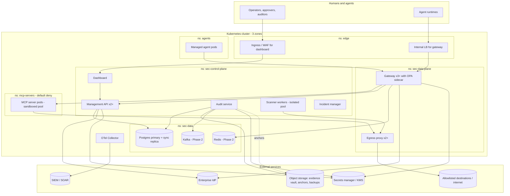
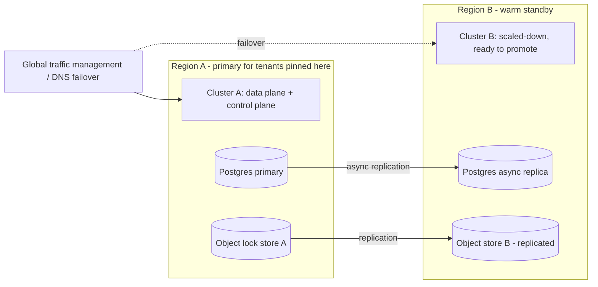
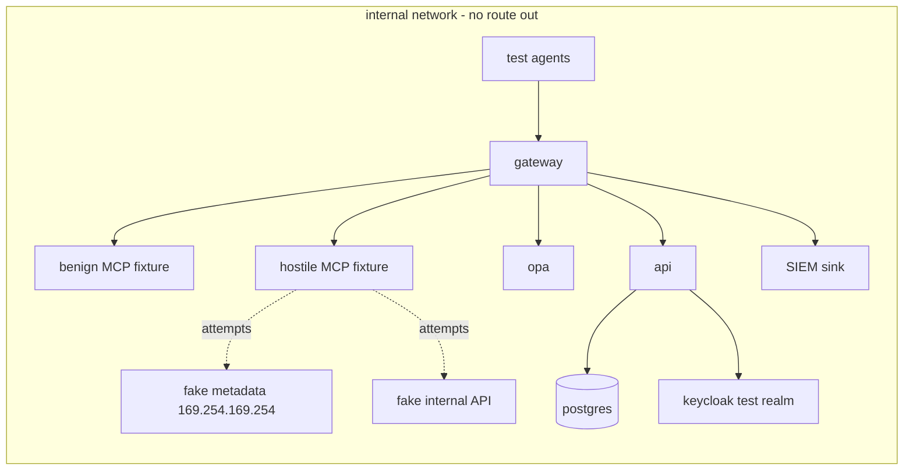

# Deployment Architecture: AgenticSecCtl

| | |
|---|---|
| Version | 0.4 (design draft; nothing is deployed or tested) |
| Depends on | `Plan/architecture.md` v0.6 (Sections 2, 4, 8, 9, 12), `Plan/functional-spec.md` v0.8 (NFR-1..10, FR-ADM-*, FR-SSRF-*, FR-SUP-*), `Plan/threat-model.md` v0.5, `controls/catalogue.md` v0.6 (CTL-08, CTL-22, CTL-24, CTL-27), `docs/runbooks/operational-runbook.md` v0.3 (Sections 6, 7, 11), `docs/ci-cd-pipeline.md` v0.6, `docs/testing/cases.md` v0.5 |
| Purpose | Where each component runs, how the network and trust zones are enforced, how data is stored and protected, how the platform stays available and recovers, and how it scales across tenants, regions and clouds. Extends `Plan/architecture.md` Section 8; if the two disagree, resolve the conflict in both. |
| Unverified | Product, cloud-service and Kubernetes feature statements are from background knowledge and tagged **[VERIFY]**. Sizing, replica counts beyond those in the architecture, and timeouts are placeholders marked "to be set". No figure here has been measured. |

## 1. Deployment principles

1. **Trust zones become network and identity boundaries.** Zones Z0..Z5 (architecture Section 2) map to namespaces, network policies and workload identities; a boundary that exists only on a diagram does not count.
2. **Default deny everywhere.** Ingress and egress are denied unless a rule allows them; MCP servers cannot reach the internet or internal systems except through allowlisted routes (FR-RT-7, CTL-08).
3. **Plane separation.** Data plane (gateway, OPA, egress proxy) and control plane (API, scanner, audit, UI) have separate deployments, service accounts, credentials and network paths; the secrets/evidence zone is separate again (architecture Section 2).
4. **Fail closed.** Deployment choices must preserve the rule that loss of PDP, registry, bundle freshness, revocation lookup or audit capacity results in denial, not bypass (FR-AUTHZ-8, FR-ID-7, FR-AUD-7).
5. **No long-lived secrets in workloads.** Workloads use federated workload identity and short-lived credentials from the broker; secrets are mounted from an external manager, never baked into images or manifests (NFR-9).
6. **Only verified artifacts run.** Images are signed, pinned by digest and verified at admission (FR-SUP-1, TC-L4).
7. **Everything declarative and reviewed.** Cluster and application configuration is in source control, changes are reviewed, and drift from the declared state is detected (CI/CD pipeline Sections 5 and 10).
8. **Cloud-neutral core, cloud-specific adapters.** The same charts run on any conformant Kubernetes; identity, storage, KMS, object lock and load balancers are behind adapters (Section 12).

## 2. Environments

| Environment | Purpose | Runtime | Data | Secrets and identity | Who can access |
|---|---|---|---|---|---|
| Local development | Developer loop | Docker Compose | Synthetic only | Development IdP (Keycloak), throwaway keys | Developer |
| CI end-to-end | Automated adversarial tests | Docker Compose profile `e2e` on an internal-only network | Synthetic; canary secrets and PII (FX-CANARY) | Test realm, ephemeral keys | CI only |
| Staging | Pre-production verification, canary of releases and policy bundles | Kubernetes, same charts as production, smaller | Synthetic or masked; no real regulated data unless approved | Separate IdP realm/tenant, separate KMS keys | Engineers with approval; no production credentials |
| Production | Live service | Kubernetes, HA, one or more regions | Real tenant data | Customer IdP, production KMS, break-glass sealed (FR-ADM-6) | Operators under SoD; no raw evidence access for operators |

Rules: production credentials never exist in lower environments; hostile fixture servers (`tests/fixtures/evil_mcp`) run only in local and CI environments on networks with no route to the internet or host services; a promotion path (CI/CD stage 4) is the only way code reaches staging and production.

## 3. Reference topology (single region, single cluster per environment)



### 3.1 Workloads

| Workload | Kind | Replicas (production) | Placement | State | Notes |
|---|---|---|---|---|---|
| Gateway (PEP) + OPA sidecar | Deployment | At least 3, spread across zones (architecture Section 9) | Data-plane node pool, anti-affinity by zone/node | Stateless except in-memory session/registry cache | PodDisruptionBudget keeps a majority available; HPA on CPU, concurrent sessions and p95 latency |
| Egress proxy | Deployment | At least 2 across zones | Data-plane node pool | Stateless; allowlists from registry | Only route out of the cluster for servers and scanner (FR-RT-7) |
| Management API | Deployment | At least 2 | Control-plane pool | Stateless | Separate service account from gateway |
| Dashboard | Deployment | At least 2 | Control-plane pool | Stateless | Behind ingress with WAF **[VERIFY]**; OIDC with MFA |
| Audit service | Deployment | At least 2 | Control-plane pool | Stateless; owns chain computation via DB | Single-writer sequencing handled in database; anchoring job as CronJob |
| Incident manager | Deployment | At least 2 | Control-plane pool | Stateless | Containment actions remain available through API/break-glass |
| Scanner workers | Job or queue-driven Deployment | Scaled on queue age | **Isolated sandbox pool** | Ephemeral | Unprivileged, no credentials, CPU/memory/time caps, egress only via SSRF guard (FR-SCAN-6) |
| MCP server pods (platform-hosted) | Deployment per server | Per owner | **Sandbox pool** (gVisor/Kata class **[VERIFY]**) | Per server | Non-root, read-only root filesystem, no privileged capabilities, resource limits (FR-EXEC-1) |
| Postgres | Managed service or operator-run cluster | Primary + synchronous replica across zones | Data pool or managed | Persistent, encrypted | Row-level security; PITR backups (Section 6) |
| Redis (Phase 2) | Managed or operator-run, HA | 3 nodes or equivalent | Data pool | Sessions, revocation list cache | Revocation lookup failure denies (FR-ID-7) |
| Kafka (Phase 2) | Managed or operator-run | 3 brokers | Data pool | Event stream | Outbox is the source of truth; Kafka is optional until volume demands it |
| OTel Collector | DaemonSet and/or gateway-mode Deployment | Per node / 2 | All pools | Stateless | Redacts secrets before export |
| Bundle server / policy distribution | Deployment or object storage | 2 | Control-plane pool | Signed bundles | Gateways pull; unsigned or stale bundles are rejected (FR-POL-3) |

Replica counts of 3 for the gateway and a synchronous Postgres replica come from the architecture; every other number is a proposal to be set during sizing.

### 3.2 Node pools

| Pool | Contents | Isolation reason |
|---|---|---|
| `data-plane` | Gateway, egress proxy | Crown-jewel path; no untrusted code |
| `control-plane` | API, UI, audit, incident manager | Separate failure and credentials |
| `sandbox` | MCP server pods, scanner workers | Runs untrusted or third-party code; stronger runtime isolation; no mix with the other pools (TC-X8, PB-14) |
| `data` | Postgres, Redis, Kafka (if self-run) | Storage performance, encryption, backup |

Taints and node selectors keep workloads on their pool; admission policy rejects workloads that violate placement.

## 4. Network architecture

### 4.1 Paths

| Path | Route | Controls |
|---|---|---|
| Agent → gateway | Internal load balancer → gateway Service; mTLS or TLS 1.2+ (target 1.3) | Sender-constrained tokens (FR-AUTHN-2); rate limits; no public exposure unless a tenant requires it |
| Human → dashboard/API | Ingress with TLS and WAF **[VERIFY]** → UI/API | OIDC with MFA; step-up for approvals; separate hostname from the gateway |
| Gateway → MCP server | Gateway pods → server pods (in-cluster) or → external server through egress proxy | Pinned certificate/JWKS (FR-AUTHN-5); namespaced addressing |
| MCP server → anywhere else | Only via egress proxy to the server's allowlist | Network policy; DNS policy; SSRF guard (FR-SSRF-*) |
| Scanner → servers | Via egress proxy / SSRF guard library | No direct egress |
| Services → Postgres/Redis/Kafka | In-cluster or private endpoints | Network policy; TLS; credentials from the broker |
| Services → IdP, KMS, secrets manager, object storage | Private endpoints where available; otherwise allowlisted egress | Least-privilege workload identity |
| Telemetry → SIEM | OTel Collector → SIEM endpoint | Redaction, control-character escaping (FR-AUD-5) |

### 4.2 Network policy matrix (target; all other traffic denied)

Default-deny must also allow cluster DNS explicitly: on AKS the documentation states that a default-deny egress policy blocks DNS traffic (read 2026-11-22, see `docs/cloud-adapter-verification.md` Section 4). Treat that as true on every cloud until tested, and add DNS allow rules to the baseline policy and to DA-1.

| From \ To | gateway | OPA (sidecar) | egress proxy | API | audit | Postgres | Redis | MCP servers | Internet/allowlist |
|---|---|---|---|---|---|---|---|---|---|
| Agents (ns agents) | allow (443) | — | — | — | — | — | — | deny | deny |
| Gateway | — | local (localhost) | allow | allow (registry, events) | allow (outbox) | deny (uses API/cache) | allow | allow | deny (via proxy only) |
| MCP servers | deny (no callbacks except defined) | — | allow | deny | deny | deny | deny | deny (no lateral) | deny except via proxy |
| Scanner workers | — | — | allow | allow (results) | — | deny | deny | deny (via proxy) | deny except via proxy |
| API | — | — | — | — | allow | allow | deny | deny | deny |
| Audit | — | — | — | — | — | allow | deny | deny | deny (object storage and SIEM via private route or allowlist) |

Rules that must hold regardless of implementation (tests: TC-X2, TC-I4, TC-H1):
- Agent pods cannot connect to MCP server pods directly.
- MCP server pods cannot connect to each other, to the control plane, to Postgres, or to cloud metadata endpoints (169.254.169.254 and cloud equivalents).
- Only the egress proxy has a route out; DNS is served by an internal resolver that applies the same policy and logs queries.
- Cloud instance metadata is blocked at node and pod level **[VERIFY per cloud]**. On AWS (documentation-verified, see `docs/cloud-adapter-verification.md`): requiring IMDSv2 alone is not enough, because the recommended hop limit of 2 for containers lets pods reach the service, so pod access must be blocked by network policy or equivalent and workloads must use workload identity instead of node credentials. Default deny needs the network policy engine in a mode that denies from pod start (on EKS the VPC CNI "strict" mode; in the default "standard" mode pods start with allow-all until policies apply), with explicit DNS allow rules and no reliance on policies for host-network pods.

### 4.3 Service-to-service identity and encryption
- In-cluster traffic uses mutual TLS with workload certificates, either from a service mesh or from a certificate manager with sidecar-less TLS libraries. **Decision needed** (mesh versus cert-manager) because a mesh adds proxies on the hot path and affects NFR-1 **[VERIFY overhead]**.
- Certificates are short-lived and rotated automatically; expiry monitoring follows the runbook (warn at 30 days, page at 7 days remaining) so a failed rotation is noticed early.
- Pinned server certificates or JWKS for registered MCP servers are stored in the registry (FR-AUTHN-5).

## 5. Identity, secrets and keys in the deployment

| Concern | Design |
|---|---|
| Workload identity | Pod identity tokens or federated credentials are for reaching the platform's own cloud resources, not upstream MCP servers; on Azure the exchanged Entra token lasts up to 24 hours (read 2026-11-22), far longer than the 10 min access token target, so the broker never hands such tokens to servers. Each Deployment has its own Kubernetes service account mapped to a cloud IAM role or secrets-manager identity with least privilege; no shared service accounts; no static cloud keys. On AWS (documentation-verified) EKS Pod Identity issues temporary, automatically rotated credentials per service account and supports a target role in another account; associations are eventually consistent, so change them outside hot paths. Other clouds **[VERIFY]** |
| Secrets | External secrets manager mounted through CSI or fetched at start with short TTL; Kubernetes Secrets only if encrypted at rest with a KMS provider **[VERIFY]**; nothing in Helm values committed to Git |
| Upstream credentials for servers | Minted by the token broker per call or session, audience-bound; the gateway holds no long-lived upstream secrets (FR-AUTHN-3) |
| Encryption keys | KMS-held keys; separate keys for database, evidence vault, backups, policy-bundle signing; per-tenant keys in Phase 5 (FR-ADM-2) |
| Policy-bundle signing | Key in KMS/HSM, usable only by the release job (CI/CD Section 6) |
| Break-glass | Sealed credentials; second-person approval; recorded sessions; rotation after use (FR-ADM-6) |
| Kubernetes API and RBAC | Private API endpoint or restricted CIDR; no cluster-admin for humans in normal operation; operators have no access to evidence-vault contents (SoD-3) |

## 6. Data tier

### 6.1 Postgres
- Topology: primary plus synchronous replica in another zone; asynchronous replica in a second region from Phase 5; connection pooling in front.
- Protections: TLS, encryption at rest with KMS key, row-level security on every tenant table, separate database roles: application (no DDL), migration (DDL, used only by the release job), audit writer (insert-only on audit tables), read-only reporting (FR-AUD-1, TC-Z6).
- Backups: continuous WAL archiving to object storage with PITR, plus periodic base backups; backup encryption with a separate key; restore tests monthly with audit chain verification (runbook 5.3, 7.9).
- Managed service vs operator-run: **open decision**; criteria are HA behaviour, ability to enforce insert-only roles and RLS, backup/PITR features, and cost **[VERIFY per cloud]**.

### 6.2 Evidence vault and anchor store
- Object storage with object lock (write-once retention) for anchors and for raw evidence, versioning enabled, encryption with a dedicated key, access limited to the audit service writer identity and named incident/security roles **[VERIFY object-lock availability per cloud]**.
- Anchors in a different account/project (or at least different credentials) from the database so a database-level actor cannot rewrite both (CTL-13). On AWS (documentation-verified): S3 Object Lock needs a versioned bucket; compliance mode cannot be removed by any user including the account root; legal holds provide indefinite protection until released.
- Retention classes and legal hold per NFR-6.
- On every cloud the retention policy must be **locked** (Azure: a locked time-based policy, since unlocked policies give no delete protection; Google Cloud: a locked bucket retention policy, summary only; AWS: compliance mode). A configured but unlocked policy does not meet CTL-13. Azure immutable storage is incompatible with storage-account point-in-time restore, so recovery of evidence relies on separate copies (read 2026-11-22).

### 6.3 Redis and Kafka (Phase 2)
- Redis: HA with persistence suited to the revocation list and sessions; loss of Redis must degrade to deny for revocation lookups, not skip them (FR-ID-7); sessions may be re-established. Licence and fork status **[VERIFY]**.
- Kafka: optional until event volume or SIEM integration needs it; the database outbox remains the source of truth, so Kafka loss delays export but does not lose events.

### 6.4 Data residency and tenancy placement
Tenant data (database rows, evidence, backups, anchors) is stored in the tenant's pinned region (FR-ADM-4, Phase 5). The control plane for a tenant runs in the same region; global services (identity federation, status page) hold no tenant data.

## 7. Hardening baseline

| Area | Requirement | Related |
|---|---|---|
| Pod security | Non-root, read-only root filesystem, drop all capabilities, `seccomp` runtime default or stricter, no privilege escalation, no host namespaces or hostPath, resource requests and limits | FR-EXEC-1, CTL-11 |
| Admission control | Reject: unsigned or tag-only images, privileged pods, missing limits, wrong node pool, namespaces without NetworkPolicy; verify signer identity (Kyverno or Gatekeeper, **decision open** and **[VERIFY]**) | FR-SUP-1, TC-L2 |
| Images | Minimal base images pinned by digest, SBOM attached, scanned (CI/CD stage 2) | CTL-17 |
| Runtime detection | Syscall/behaviour detection on all pools, higher sensitivity on the sandbox pool (Falco-class tools **[VERIFY]**) | TC-X8, PB-11, PB-14 |
| Nodes | Hardened, minimal OS images, automatic patching windows, no SSH in production (use controlled debug access), kubelet authn/authz enabled | NFR-9 |
| Control plane (Kubernetes) | etcd and Secrets encrypted at rest, audit logging enabled and exported, API access restricted | NFR-9 |
| Sandbox pool | Stronger runtime isolation (gVisor/Kata class **[VERIFY compatibility and overhead]**), no shared nodes with other pools, egress only via proxy | Threat O, PB-14 |
| Time | NTP synchronised for audit ordering and token validation | ISO-style logging control; FR-AUD-1 |

## 8. Availability, scaling and disaster recovery

### 8.1 Failure domains

| Failure | Design response | Expected behaviour |
|---|---|---|
| Pod or node loss | Replicas across nodes, PodDisruptionBudgets, readiness gates | No outage; HPA replaces capacity |
| Zone loss | At least 3 gateway replicas across zones (a zone loss leaves a majority); Postgres synchronous replica promotion | Brief failover; calls continue or are denied during promotion; no bypass |
| PDP or bundle failure | OPA per gateway pod; bundle pulled from replicated store | Stale or invalid bundle ⇒ deny (TC-Z5) |
| Database loss | Failover to replica; gateway runs from cache until TTL then denies | Runbook 8.3 |
| Audit sink or storage failure | Local durable outbox at gateway; high-impact calls denied when full (FR-AUD-7) | Runbook 8.4 |
| IdP outage | Cached keys until expiry, then deny | Runbook 8.5 |
| Region loss (Phase 5) | Warm secondary region; promote replica; restore from replicated backups and anchors | RPO ≤ 5 min and RTO ≤ 30 min targets (NFR-4); verify audit chain after failover (runbook Section 11) |

### 8.2 Multi-region (Phase 5)



- **Active/passive per tenant** is the default because audit chain ordering and data residency are simpler; active/active is deferred because chain continuity across regions needs a design of its own (to be decided in Phase 5).
- Tenants with residency constraints stay in their region; failover targets must be in the permitted set.
- Failover is a runbook procedure with human decision; automatic failover is not assumed because of audit and residency implications.

### 8.3 Scaling

| Component | Scale signal | Notes |
|---|---|---|
| Gateway | CPU, concurrent sessions, p95 added latency | Stateless; target NFR-1 (p95 ≤ 25 ms, p99 ≤ 60 ms at 1,000 req/s per instance) and NFR-5 (10,000 sessions, 5,000 calls/s cluster) are proposals to validate |
| OPA | Scales with gateway pods (sidecar) | Decision latency measured in spike S3 |
| Egress proxy | Connections and bytes | Per-destination limits |
| API/Audit | Request rate, outbox lag | Database is the bottleneck: scale vertically first, then read replicas for dashboards |
| Scanner | Queue age | Cap per-worker resources; hostile imports must fail within limits (TC-Z2) |
| Postgres | Connections, IOPS, replication lag | Pooling; partition large audit tables by time **[design decision to be made]** |

Capacity targets, headroom and cost models are "to be set" after load tests (runbook Section 12).

## 9. Multi-tenancy deployment models

| Model | Isolation | When to use | Trade-off |
|---|---|---|---|
| Shared control and data plane, logical isolation | Tenant ID everywhere, Postgres RLS, per-tenant policy bundles, per-tenant keys (Phase 5) | Default | Most efficient; weakest blast-radius separation |
| Dedicated namespaces and database per tenant, shared cluster | Network policy plus separate DB and keys per tenant | Regulated tenants wanting stronger isolation | More operations; still shared nodes unless pinned |
| Dedicated cluster (or account/project) per tenant | Full separation including nodes and KMS | Highest-assurance or sovereign requirements | Highest cost and operations |

The tenancy model is **ADR-4 (open)**: it must be decided before schema freeze, because RLS design and key hierarchy depend on it. All models must pass the cross-tenant tests (TC-I3).

## 10. Observability and operations footprint

- OpenTelemetry: SDKs in services, Collector as DaemonSet plus gateway-mode Deployment; processors drop or hash secrets and escape control characters before export; exports to SIEM and metrics/trace backends chosen by the customer **[VERIFY product options]**.
- Dashboards and alerts follow runbook Section 4; alert routing through the customer's on-call system.
- Audit events flow through the outbox to the audit service; logs never contain tokens or secrets (TC-G5).
- Kubernetes and cloud audit logs are collected and retained like application audit data.
- Status endpoints: liveness, readiness and dependency checks for every service; readiness fails when the service cannot honour fail-closed guarantees (for example gateway with stale bundle).

## 11. Configuration, release and rollout topology

- **Packaging:** Helm charts (cloud-neutral) in `deploy/helm/`, with per-environment values files and no secrets; Kubernetes policies in `deploy/k8s/` and `deploy/admission/`; Compose profiles in `deploy/compose/` (none of these exist yet).
- **Delivery:** pull-based GitOps controller or pipeline deploy **[decision open; VERIFY options]**; either way, the deploy identity is environment-scoped and deploys by digest (CI/CD stage 4).
- **Rollout order:** control-plane migrations (expand), API/scanner/audit, policy bundle in shadow mode then enforce, gateway canary then wider, dashboard (runbook Section 6).
- **Rollback:** previous digest and previous signed bundle; migrations are backward compatible so rollback of code is safe.
- **Drift detection:** continuous comparison of running images and manifests against declared state (CI/CD stage 5).
- **Policy bundle path:** CI builds and signs bundle → bundle store (replicated) → gateways pull, verify signature and freshness → decisions record bundle hash (FR-POL-2/3).

## 12. Multi-cloud adapters (Phase 5)

The same charts run on any conformant Kubernetes. The following are adapters, each requiring verification per cloud **[VERIFY all]**:

| Capability | Adapter question |
|---|---|
| Workload identity | How Kubernetes service accounts federate to cloud IAM or the secrets manager |
| Secrets and KMS | Which secrets manager and KMS; key hierarchy and per-tenant keys |
| Object lock and replication | Availability and semantics of write-once retention for evidence and anchors |
| Managed database | HA, PITR, RLS, insert-only roles, cross-region replication |
| Load balancing and DNS failover | Internal LB for the gateway, global traffic management |
| Egress and metadata hardening | Egress firewall options, IMDS hardening, private endpoints |
| Sandboxed runtimes | Support for gVisor/Kata-class runtimes on managed nodes |
| Admission and policy | Kyverno/Gatekeeper compatibility with managed clusters |
| Data residency | Region lists, sovereign cloud options |

A capability that a cloud cannot provide is recorded as a documented deviation with compensating controls, not silently skipped.

## 13. Local and CI end-to-end topology (Docker Compose)



Rules: no published ports to the host except the test runner; the network is declared internal so containers have no route to the internet; fixtures record every request so the test can assert that nothing was reached (cases Section 1); the same container images as production are used where possible; time can be faked for expiry tests.

## 14. Illustrative manifests (not validated, not deployable as is)

These show intent only; real manifests belong in `deploy/` once built and linted **[VERIFY against the Kubernetes version and CNI in use]**.

Default-deny for the MCP server namespace:

```yaml
apiVersion: networking.k8s.io/v1
kind: NetworkPolicy
metadata:
  name: default-deny-all
  namespace: mcp-servers
spec:
  podSelector: {}
  policyTypes: ["Ingress", "Egress"]
```

Allow only the gateway to reach server pods, and only the egress proxy as an outbound route (labels are placeholders):

```yaml
apiVersion: networking.k8s.io/v1
kind: NetworkPolicy
metadata:
  name: allow-gateway-in-proxy-out
  namespace: mcp-servers
spec:
  podSelector: {}
  policyTypes: ["Ingress", "Egress"]
  ingress:
    - from:
        - namespaceSelector:
            matchLabels: { name: sec-data-plane }
          podSelector:
            matchLabels: { app: gateway }
  egress:
    - to:
        - namespaceSelector:
            matchLabels: { name: sec-data-plane }
          podSelector:
            matchLabels: { app: egress-proxy }
```

Pod security settings expected on every platform workload:

```yaml
securityContext:
  runAsNonRoot: true
  allowPrivilegeEscalation: false
  readOnlyRootFilesystem: true
  capabilities: { drop: ["ALL"] }
  seccompProfile: { type: RuntimeDefault }
```

DNS egress to the internal resolver, metadata blocking and the egress proxy's own rules need CNI-specific policy and are not shown.

## 15. Deployment-level threats and mitigations

| Threat | Link | Mitigation in this architecture |
|---|---|---|
| Agents or servers bypass the gateway | X2, threat C | NetworkPolicy matrix 4.2; discovery reports gaps (CTL-26); test TC-X2 |
| MCP server pod reaches cloud metadata or internal APIs | H | Metadata blocked at node/pod; egress only via proxy; SSRF guard; TC-H1, TC-I4 |
| Container escape from a server pod | O, PB-14 | Sandbox pool and runtime, hardened pod settings, separate nodes, runtime detection |
| Compromised gateway pod pivots to control plane or other tenants | X8, PB-11 | Separate namespaces and service accounts, network policy, no long-lived secrets, per-service DB roles; TC-X8 |
| Stolen workload credentials | G | Short-lived federated identity; secrets from external manager; no static keys |
| Database administrator rewrites audit | X6, X8 | Insert-only roles, anchors in separate account with object lock (CTL-13); TC-Z6 |
| Unsigned or tampered image deployed | L | Admission verification and deploy by digest; TC-L4 |
| Noisy or hostile tenant exhausts shared capacity | K | Per-tenant rate limits and quotas; dedicated models for high-risk tenants |
| Region failover violates residency | I | Pinned failover targets; manual failover decision |
| Failover breaks audit continuity | X8 | Chain verification and anchor comparison before resuming traffic (runbook Section 11) |

## 16. Deployment acceptance criteria

| ID | Criterion | Verified by |
|---|---|---|
| DA-1 | No direct agent→server or server→server connection succeeds; only the gateway reaches servers | TC-X2 |
| DA-2 | A server pod cannot reach 169.254.169.254, RFC 1918 ranges or arbitrary internet hosts; the allowlisted destination works | TC-H1, TC-I4 |
| DA-3 | Unsigned, tag-only and privileged workloads are rejected at admission | TC-L4 |
| DA-4 | Stopping OPA or serving a stale bundle makes gateways deny; reads on the fail-open allowlist are flagged | TC-Z5 |
| DA-5 | Killing the audit service or filling the outbox denies high-impact calls and loses no events | TC-Z23; runbook 8.4 exercise |
| DA-6 | After restore or failover the audit chain verifies and matches the latest anchor | TC-Z6, runbook Section 11 |
| DA-7 | Tenant A cannot read tenant B data through API, cache, logs or backups | TC-I3 |
| DA-8 | Gateway added latency within NFR-1 under the reference load | NFR-1 load test (unmeasured) |
| DA-9 | Loss of a zone leaves the gateway serving (majority of replicas) or denying safely | Zone-failure game day |
| DA-10 | No long-lived cloud or upstream secrets are present in workload memory, environment or images | TC-X8 |

## 17. Open decisions and unverified items

| # | Item | Needed by |
|---|---|---|
| 1 | Tenancy model (ADR-4) and database layout for it | Before schema freeze |
| 2 | Service mesh versus certificate manager for mutual TLS | Phase 2 design |
| 3 | Managed versus operator-run Postgres, Redis and Kafka | Phase 1 for Postgres |
| 4 | Admission engine (Kyverno or Gatekeeper) | Phase 2 |
| 5 | GitOps controller versus pipeline-based deploy | Phase 2 |
| 6 | Sandbox runtime choice and supported clouds | Phase 2/4 |
| 7 | Audit anchoring target (ADR-7) and cross-account setup | Phase 2 |
| 8 | Stdio server handling (ADR-5): wrapper deployed as sidecar, daemonset or managed endpoint agent | Phase 2 |
| 9 | Region list, residency rules, failover policy | Phase 5 |
| 10 | Sizing, node types, quotas, cost model | After load tests |
| 11 | Every **[VERIFY]** item in this document (cloud features, runtime availability, WAF, mesh overhead, licences) | Before any implementation commitment |

The relationship to the design record: this document refines `Plan/architecture.md` Section 8. When the two are next revised together, `Plan/architecture.md` should point here for the full deployment architecture.
